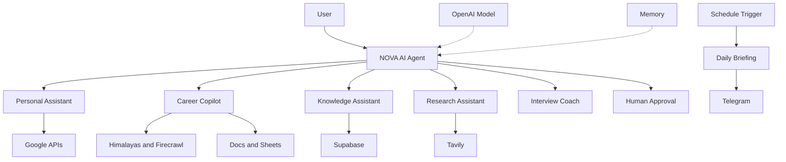

# NOVA — Building Agentic AI Systems with n8n

> From Raw LLMs to Proactive AI Assistants:
> A Hands-on Engineering Journey.


## Overview

NOVA is a modular AI assistant designed to demonstrate
how modern Agentic AI applications are engineered.

The project takes learners through an incremental
journey, starting with a raw Large Language Model
and progressively introducing:

- AI Agents and Tool Calling
- Conversation and Persistent Memory
- Workflow Orchestration
- External API Integration
- Retrieval-Augmented Generation (RAG)
- Context Engineering
- Harness Engineering
- Planning and Feedback Loops
- Human-in-the-Loop Workflows
- Proactive Automation
- AI Evaluation and Observability

Rather than building isolated AI demonstrations,
we build one application that evolves with every
chapter.

## Project Philosophy

An AI application is more than a language model.

Reliable AI systems require a carefully engineered
environment consisting of tools, context, memory,
permissions, validation and execution controls.

Every specialist workflow in NOVA follows the same
development methodology:

1. Understand the purpose.
2. Define the input and output contract.
3. Build the workflow independently.
4. Test the workflow with known inputs.
5. Validate the results.
6. Expose the workflow as an AI tool.
7. Integrate it with the main assistant.
8. Perform end-to-end testing.

## Architecture



NOVA uses a central AI Agent to orchestrate
independently implemented specialist workflows.

Deterministic workflows handle predictable operations.
Large Language Models handle reasoning, interpretation
and generation where appropriate.

## Planned Capabilities

### Personal Assistant

- Retrieve and summarize unread emails.
- Search Gmail messages.
- Prepare email drafts.
- Retrieve calendar events.
- Check calendar availability.
- Create personal focus sessions.

### Career Copilot

- Discover remote jobs using Himalayas.
- Extract job descriptions.
- Analyze resume alignment.
- Identify skill gaps.
- Generate tailored resumes.
- Maintain an application tracker.

NOVA prepares job applications but does not
automatically submit them.

### Knowledge Assistant

- Ingest documents from Google Drive.
- Generate semantic embeddings.
- Store vectors in Supabase.
- Retrieve relevant knowledge.
- Generate grounded answers with sources.
- Retrieve persistent user preferences.

### Research Assistant

- Search public web sources.
- Create bounded research plans.
- Aggregate retrieved evidence.
- Generate research reports.

### Interview Coach

- Conduct role-based mock interviews.
- Evaluate technical answers.
- Provide structured feedback.
- Track interview performance.

### Proactive Assistant

- Deliver scheduled daily briefings.
- Send notifications through Telegram.
- Queue proposed actions for human review.
- Execute explicitly approved actions.
- Record execution failures.


## Learning roadmap

- [Environment setup](docs/00-getting-started/README.md)
- [Personal AI Assistant](docs/01-personal-assistant/README.md)
- [Career Copilot](docs/02-career-copilot/README.md)
- [Knowledge Assistant](docs/03-knowledge-assistant/README.md)
- [Research and Interview](docs/04-research-and-interview/README.md)
- [Proactive Assistant](docs/05-proactive-assistant/README.md)
- [Advanced Topics](docs/06-advanced-topics/README.md)

## Technology Stack

| Technology | Purpose |
|---|---|
| n8n Community Edition | Workflow orchestration |
| Docker | Local runtime |
| OpenAI API | LLM and embeddings |
| Gmail | Email management |
| Google Calendar | Scheduling |
| Google Sheets | Structured persistence |
| Google Docs | Artifact generation |
| Google Drive | Document storage |
| Himalayas | Job discovery |
| Firecrawl | Webpage extraction |
| Supabase | Vector database |
| Tavily | Web research |
| Telegram | Notifications |

## Cost

The project is designed to use free or free-tier
services wherever possible.

OpenAI API usage is paid.

External service quotas, pricing and availability
may change over time. Review their current terms
before starting.

The project uses self-hosted n8n Community Edition
rather than requiring an n8n Cloud subscription.

## Quick start

 ### Prerequisites

- Git
- Docker Engine or Docker Desktop
- Docker Compose v2
- Web browser
- OpenAI API account

Clone this repository:

```bash
git clone https://github.com/sanjaynegi-ai/nova-agentic-ai-assistant.git
cd nova-agentic-ai-assistant
```

Copy `.env.example` to `.env`.

Start n8n:

```bash
docker compose pull
docker compose up -d
```

Open:

http://localhost:5678

Complete the initial n8n account setup.

Once the setting up of n8n account is done, you can start with the course.

*[START HERE: Chapter 0 - Environment setup](docs/00-getting-started/README.md)*
---

## About the mentor

**Sanjay Negi** brings 23+ years of industry experience and helps experienced software
engineers and technology leaders transition into high-value AI roles, including
**AI Engineer**, **Forward Deployed Engineer**, and **GenAI Architect**. He has trained
more than 1,100 experienced engineers.

<p align="center">
  
</p>

<p align="center"><strong>#SkillUpWithSanjay</strong></p>

<p align="center">
  <a href="https://www.sanjaynegi.in" target="_blank" rel="noopener noreferrer">Website</a>
  &nbsp;&middot;&nbsp;
  <a href="https://www.linkedin.com/in/sanjay-negi-ai/" target="_blank" rel="noopener noreferrer">LinkedIn</a>
</p>
