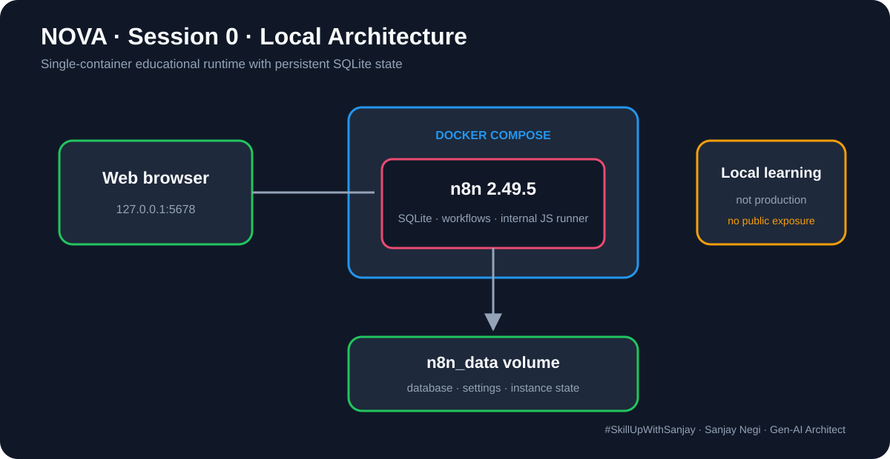

> **NOVA — Building Agentic AI Systems with n8n**  
> **Session 0 · Milestone 0.1 — Docker Installation and Local n8n Environment**

# Run NOVA's Local n8n Environment

[NOVA](../../README.md) / **Session 0 · Milestone 0.1**

**Status:** Runtime Verified  
**Verified documentation date:** 2026-11-26 · **Pinned stable n8n:** `2.49.5`

## Objective

Build a private, reproducible learning environment using one n8n Community Edition container, Docker Compose, SQLite, an explicit encryption key, and a persistent Docker volume. This milestone does not configure OpenAI, Google, or any other provider.

## Learning path

1. [Learn the prerequisites](prerequisites.md).
2. [Install Docker](docker-installation.md).
3. [Install and initialize n8n](n8n-installation.md).
4. Keep the [Docker command reference](docker-command-reference.md) nearby.
5. [Back up, restore, upgrade, and roll back](backup-and-restore.md).
6. Use [troubleshooting](troubleshooting.md) when expected results differ.
7. Record evidence in the [Milestone 0.1 verification checklist](../../tests/session-00-verification.md).

## Local architecture

- Your browser reaches n8n only at `127.0.0.1:5678`; the editor is not published to your LAN or the internet.
- The n8n container uses SQLite by default and stores the database, instance settings, and related state under `/home/node/.n8n`.
- The named `n8n_data` volume persists that directory when containers are replaced.
- n8n uses its internal JavaScript runner in this local educational configuration; Python Code node support and hardened production isolation are not claimed.

## Scope boundary

Milestone 0.1 ends after local owner creation and persistence verification. Credentials, provider APIs, sample-data setup, and all Session 1 capabilities are later milestones.

## Session 0 milestone sequence

Session 0 is pre-work, separate from the five mandatory 90-minute implementation sessions. Milestone 0.1 is implemented and Runtime Verified; Milestone 0.2 is the next authorized milestone.

1. **0.1 — Docker and n8n Installation** — Runtime Verified.
2. **0.2 — Understanding n8n Fundamentals** — next authorized milestone.
3. **0.3 — OpenAI Credentials and Connectivity Testing** — planned.
4. **0.4 — Google OAuth and API Credentials** — planned.
5. **0.5 — Sample Data Preparation** — planned.
6. **0.6 — Final Verification and GitHub Promotion** — planned.

## Official sources

- [n8n: install using Docker Compose](https://docs.n8n.io/deploy/host-n8n/install-options/install-using-docker-compose/)
- [n8n: Docker installation and stable-version guidance](https://docs.n8n.io/hosting/installation/docker/)
- [n8n: task runners](https://docs.n8n.io/hosting/configuration/task-runners/)
- [n8n: timezone variables](https://docs.n8n.io/hosting/configuration/environment-variables/timezone-localization/)
- [n8n: custom encryption key](https://docs.n8n.io/hosting/configuration/configuration-examples/encryption-key/)
- [n8n releases](https://github.com/n8n-io/n8n/releases)
- [Docker Compose installation](https://docs.docker.com/compose/install/)
- [Docker volumes](https://docs.docker.com/engine/storage/volumes/)

Interfaces and versions change. Recheck these sources before a workshop or upgrade.

## Navigation

[NOVA home](../../README.md) · [Next: Prerequisites →](prerequisites.md)

---

  

<strong>#SkillUpWithSanjay</strong>

  <strong>Sanjay Negi — Senior Principal Software Engineer | Gen-AI Architect</strong> 
  <a href="https://www.sanjaynegi.in">Website</a> ·
  <a href="https://www.linkedin.com/in/sanjay-negi-ai/">LinkedIn</a> ·
  <a href="../../LICENSE">MIT License</a>

