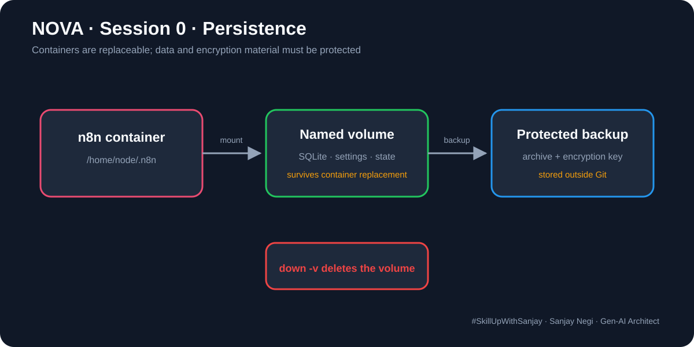

> **NOVA — Building Agentic AI Systems with n8n** · **Session 0 · Milestone 0.1**

# Backup, Restore, Upgrade, and Rollback

[NOVA](../../README.md) / [Milestone 0.1](README.md) / **Backup and restore**

## What must be protected

The `n8n_data` volume contains SQLite data and n8n instance state. The ignored `.env` contains the explicit encryption key. A volume backup without the matching encryption key may restore workflows while leaving credentials unreadable.

Store backups outside the repository with restricted access. Store the encryption key separately in a password manager or approved secrets vault. Never commit `.env` or backup archives.



- n8n writes SQLite and settings to `/home/node/.n8n` inside the mounted volume.
- The backup process archives volume contents while n8n is stopped, avoiding an inconsistent SQLite snapshot.
- Restore targets a newly created empty volume and requires the original encryption key.

## Create a consistent backup

1. Use `docker compose ps` to record the current state.
2. Stop services with `docker compose stop`; this is non-destructive.
3. Identify the exact volume with `docker volume ls`. Compose typically prefixes it with the project directory name.
4. Create a protected backup directory outside the Git repository.

PowerShell example after replacing both absolute paths and the exact volume name:

```powershell
docker run --rm --mount type=volume,src=nova-agentic-ai-assistant_n8n_data,dst=/source,readonly --mount type=bind,src=C:\secure-nova-backups,dst=/backup alpine:3.22 tar -czf /backup/n8n-data-YYYY-MM-DD.tar.gz -C /source .
```

Bash:

```bash
docker run --rm --mount type=volume,src=nova-agentic-ai-assistant_n8n_data,dst=/source,readonly --mount type=bind,src=/secure/nova-backups,dst=/backup alpine:3.22 tar -czf /backup/n8n-data-YYYY-MM-DD.tar.gz -C /source .
```

Start services again with `docker compose start`. Confirm the archive exists and is non-empty. Also back up `.env` to the secrets vault; do not place it beside publicly shareable artifacts.

## Restore safely

Restore is destructive when it targets a populated volume. Do not perform it merely to “test” production data. Use a separate test volume first.

1. Stop the stack.
2. Confirm the backup archive and encryption key are available.
3. Create a new empty test volume: `docker volume create nova_n8n_restore_test`.
4. Extract the archive into that new volume with an Alpine helper container and a read-only backup bind mount.
5. Point a temporary, localhost-only Compose override at the test volume and start it.
6. Confirm workflows open and encrypted credentials remain readable before considering a real replacement.

Do not document or automate deletion of the original volume in this milestone.

## Upgrade safely

1. Check the [official n8n releases](https://github.com/n8n-io/n8n/releases) and choose a release marked stable—not beta.
2. Read release notes and migration guidance.
3. Back up volume data and `.env`; verify both.
4. Change only `N8N_VERSION` in `.env`. n8n and runner tags must match.
5. Run `docker compose config --quiet`, then `docker compose pull`.
6. Run `docker compose up -d`, inspect status/logs, and run the persistence check.
7. Record version and evidence before marking the upgrade verified.

## Roll back cautiously

Database migrations may prevent an older release from using data already upgraded by a newer release. A safe rollback restores the pre-upgrade volume backup and original encryption key, then restores the prior `N8N_VERSION`. Simply changing the tag backward is not a reliable rollback.

## Navigation

[← Command reference](docker-command-reference.md) · [Next: Troubleshooting →](troubleshooting.md)

---

<p align="center">
  
</p>
<p align="center"><strong>#SkillUpWithSanjay</strong></p>
<p align="center">
  <strong>Sanjay Negi — Senior Principal Software Engineer | Gen-AI Architect</strong><br>
  <a href="https://www.sanjaynegi.in">Website</a> ·
  <a href="https://www.linkedin.com/in/sanjay-negi-ai/">LinkedIn</a> ·
  <a href="../../LICENSE">MIT License</a>
</p>
