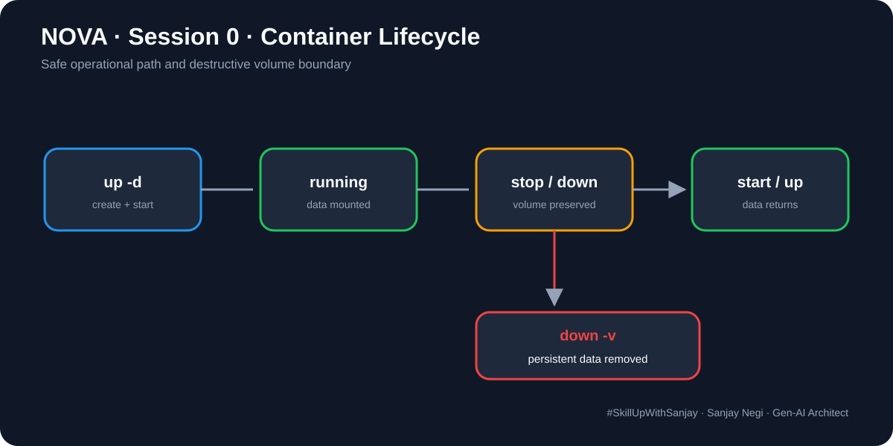

> **NOVA — Building Agentic AI Systems with n8n** · **Session 0 · Milestone 0.1**

# Docker Command Reference

[NOVA](../../README.md) / [Milestone 0.1](README.md) / **Command reference**

Run these commands from the repository root. PowerShell and Bash forms are identical unless noted.

| Command | Purpose | Data impact |
|---|---|---|
| `docker compose config --quiet` | Validate resolved configuration | None |
| `docker compose pull` | Download configured images | Keeps containers and volume |
| `docker compose up -d` | Create/start services in background | Keeps existing volume |
| `docker compose ps` | Show service state and ports | None |
| `docker compose logs --tail=100 n8n` | Read recent n8n logs | None |
| `docker compose logs -f` | Follow logs; press `Ctrl+C` to stop following | Does not stop containers |
| `docker compose exec -T n8n n8n --version` | Print installed n8n version | None |
| `docker compose restart` | Restart services | Keeps volume |
| `docker compose stop` | Stop services without removing containers | Keeps volume |
| `docker compose start` | Start previously stopped containers | Keeps volume |
| `docker compose down` | Stop and remove project containers/network | Keeps named volume by default |
| `docker volume ls` | List volumes | None |
| `docker compose images` | Show images used by services | None |

## Destructive commands

> **Warning:** Do not execute these during normal setup.

| Command | Why it is destructive |
|---|---|
| `docker compose down -v` | Removes the project containers **and named volume**, deleting local n8n state |
| `docker volume rm <volume>` | Deletes the named volume when it is unused |
| `docker system prune --volumes` | Can delete unused volumes and unrelated Docker data |

Back up and verify the backup before any destructive operation. Never copy a placeholder volume name into a deletion command; identify the exact target first.

## Container lifecycle

- `up -d` creates or replaces containers from the Compose definition.
- `stop`/`start` retain the same container; `down`/`up` may replace it.
- The named volume survives normal stop, restart, recreation, and `down` operations.
- Adding `-v` to `down` crosses the destructive boundary and removes persistent state.

## Navigation

[← n8n installation](n8n-installation.md) · [Next: Backup and restore →](backup-and-restore.md)

---

  

<strong>#SkillUpWithSanjay</strong>

  <strong>Sanjay Negi — Senior Principal Software Engineer | Gen-AI Architect</strong> 
  <a href="https://www.sanjaynegi.in">Website</a> ·
  <a href="https://www.linkedin.com/in/sanjay-negi-ai/">LinkedIn</a> ·
  <a href="../../LICENSE">MIT License</a>

