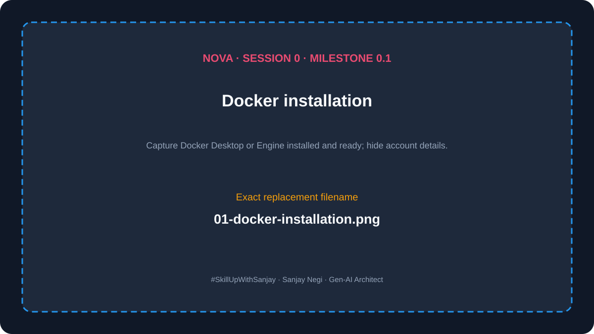
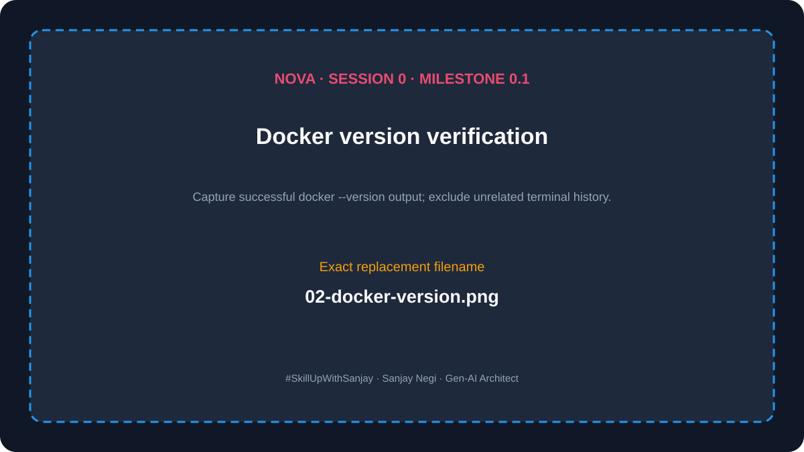
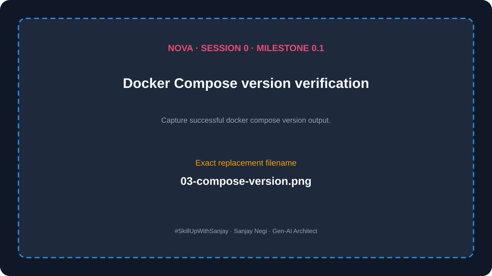
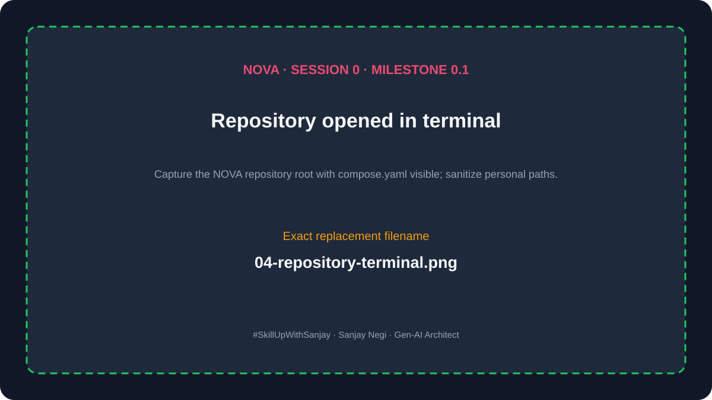

> **NOVA — Building Agentic AI Systems with n8n** · **Session 0 · Milestone 0.1**

# Install and Verify Docker

[NOVA](../../README.md) / [Milestone 0.1](README.md) / **Docker installation**

## Windows

1. Check Docker's current [Windows requirements](https://docs.docker.com/desktop/setup/install/windows-install/), including WSL 2 and virtualization.
2. Download Docker Desktop from Docker's official site and follow its installer. Select the WSL 2 backend when appropriate for your system.
3. Restart Windows if requested, open Docker Desktop, and wait until the engine reports it is running.



- Capture Docker Desktop's successful running state without account details or unrelated containers.

## macOS

1. Check whether the Mac uses Apple silicon or Intel from **Apple menu → About This Mac**.
2. Download the matching Docker Desktop package from the [official installation page](https://docs.docker.com/desktop/setup/install/mac-install/).
3. Install, launch Docker Desktop, accept the applicable terms, and wait for the engine to start.

## Linux

For a workstation, Docker Desktop is available. For a server or a system without a desktop, install Docker Engine from the [official distribution-specific guide](https://docs.docker.com/engine/install/) and install the [Compose plugin](https://docs.docker.com/compose/install/linux/). Avoid the legacy `docker-compose` standalone binary.

After installation, configure non-root Docker access only if your platform policy permits it; Docker daemon access is effectively privileged host access.

## Verify the engine

The version command confirms the client exists:

```powershell
docker --version
```

```bash
docker --version
```



- Capture the version output without unrelated terminal history.

The following command confirms the Docker client can reach the engine—not merely that the CLI is installed:

```powershell
docker info
```

```bash
docker info
```

The Compose command confirms Compose v2 is installed:

```powershell
docker compose version
```

```bash
docker compose version
```



- Capture a successful `docker compose version`; the command contains a space, not the legacy hyphenated form.

## Clone and open NOVA

`git clone` downloads the repository; `Set-Location` or `cd` makes it the active directory.

PowerShell:

```powershell
git clone https://github.com/sanjaynegi-ai/nova-agentic-ai-assistant.git
Set-Location nova-agentic-ai-assistant
Get-Location
Get-ChildItem compose.yaml
```

Bash:

```bash
git clone https://github.com/sanjaynegi-ai/nova-agentic-ai-assistant.git
cd nova-agentic-ai-assistant
pwd
ls -l compose.yaml
```

If you already have the repository, do not clone over it; open its existing directory.



- Capture the repository path and `compose.yaml`, excluding personal parent paths when necessary.

## Navigation

[← Prerequisites](prerequisites.md) · [Next: Install n8n →](n8n-installation.md)

---

<p align="center">
  
</p>
<p align="center"><strong>#SkillUpWithSanjay</strong></p>
<p align="center">
  <strong>Sanjay Negi — Senior Principal Software Engineer | Gen-AI Architect</strong><br>
  <a href="https://www.sanjaynegi.in">Website</a> ·
  <a href="https://www.linkedin.com/in/sanjay-negi-ai/">LinkedIn</a> ·
  <a href="../../LICENSE">MIT License</a>
</p>
