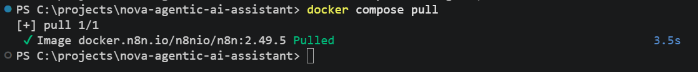
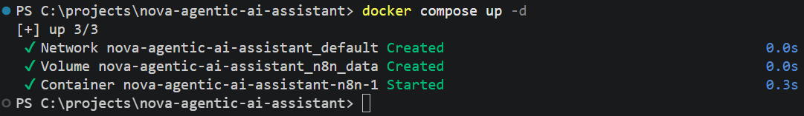
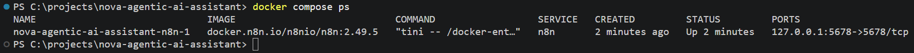
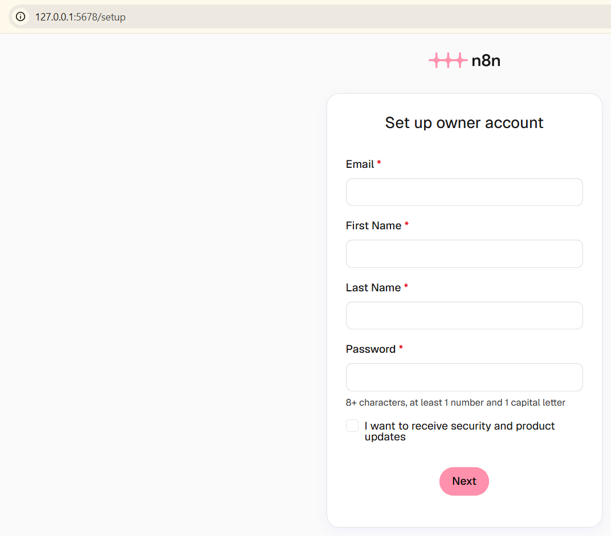
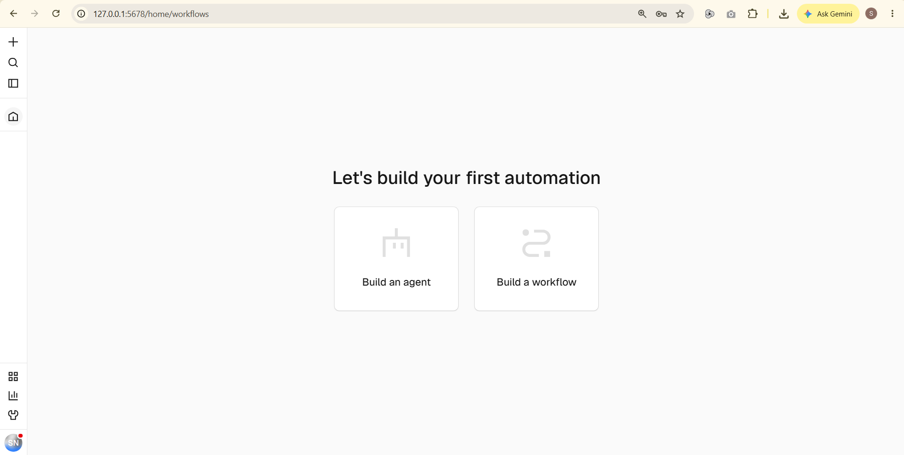
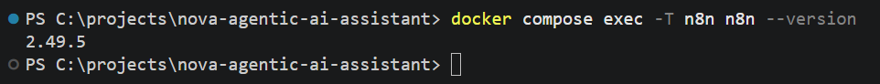
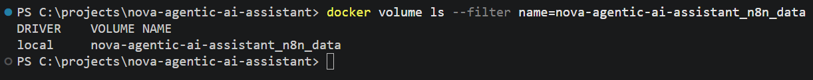
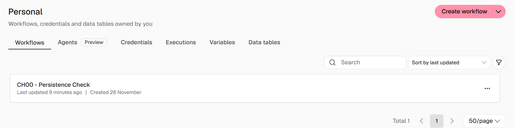

> **NOVA — Building Agentic AI Systems with n8n** · **Session 0 · Milestone 0.1**

# Install and Initialize n8n

[NOVA](../../README.md) / [Milestone 0.1](README.md) / **n8n installation**

## 1. Prepare `.env`

Copying the example creates local configuration without editing the committed template.

PowerShell:

```powershell
Copy-Item .env.example .env
```

Bash:

```bash
cp .env.example .env
```

Generate **one** random encryption key using either PowerShell **or** OpenSSL. These are alternative methods; do not run both.

### Option A: PowerShell

```powershell
$bytes = New-Object byte[] 32
$rng = [Security.Cryptography.RandomNumberGenerator]::Create()
$rng.GetBytes($bytes)
$key = [Convert]::ToBase64String($bytes)
$rng.Dispose()
$key
```

The last command, `$key`, displays a Base64-encoded value, typically 44 characters long. Copy that displayed value.

### Option B: Bash with OpenSSL

```bash
openssl rand -hex 32
```

OpenSSL displays a hexadecimal value 64 characters long. Copy that displayed value.

Both options generate 32 random bytes and are equally suitable for n8n. Their outputs look different because PowerShell encodes the bytes as Base64 while the OpenSSL command encodes them as hexadecimal. If you run both commands, the values will also differ because each command generates new random bytes. Choose only one output.

In `.env`, replace the placeholder with the chosen value, without quotation marks, spaces, or angle brackets:

```dotenv
N8N_ENCRYPTION_KEY=paste-your-chosen-generated-value-here
```

Save the same chosen value in a password manager. Do not generate a new key each time n8n starts: losing or changing this key can make stored n8n credentials unreadable after a restart or restore. Never commit `.env`.

## 2. Understand `compose.yaml`

| Field | Meaning |
|---|---|
| `services` | Defines the related containers Compose manages |
| `n8n.image` | Official n8n image with configurable pinned tag |
| `restart: unless-stopped` | Restarts after failure/host restart unless deliberately stopped |
| `127.0.0.1:5678:5678` | Publishes the editor only on host loopback |
| `TZ` | Container operating-system timezone |
| `GENERIC_TIMEZONE` | n8n timezone used by schedule-oriented nodes |
| `N8N_ENFORCE_SETTINGS_FILE_PERMISSIONS` | Enforces secure permissions on n8n settings |
| `N8N_DIAGNOSTICS_ENABLED` | Disables optional diagnostics collection for this local lab |
| `N8N_UNVERIFIED_PACKAGES_ENABLED` | Prevents installation of unverified community packages |
| `N8N_ENCRYPTION_KEY` | Encrypts stored n8n credentials; supplied from ignored `.env` |
| `n8n_data:/home/node/.n8n` | Persists SQLite, settings, encryption-related state, and workflows |
| `volumes.n8n_data` | Declares the named persistent volume |

No database variables are set, so n8n uses SQLite by default. This milestone has no PostgreSQL, Redis, reverse proxy, or public tunnel.

## 3. Validate and pull

On Windows or macOS, start Docker Desktop and wait until it reports that the Docker Engine is running before continuing. On Linux, make sure the Docker service is running. The `docker compose config --quiet` command itself only validates the Compose configuration and normally does not need the engine, but the following `pull` and `up` commands do.

`config --quiet` validates and resolves Compose configuration without starting containers. This command is the same in PowerShell and Bash:

```bash
docker compose config --quiet
```

`pull` downloads the pinned n8n image without starting it:

```bash
docker compose pull
```
<figure style="border:1px solid #ccc; padding:10px; border-radius:8px;">
  
  <figcaption><strong>Powershell Screenshot:</strong> Image pulled</figcaption>
</figure>

- Capture the successful pinned n8n image pull without registry credentials.

## 4. Start and inspect

`up -d` creates the private network and volume, then starts the n8n container in the background:


```bash
docker compose up -d
```

<figure style="border:1px solid #ccc; padding:10px; border-radius:8px;">
  
  <figcaption><strong>Powershell Screenshot:</strong> Container Started</figcaption>
</figure>


- Capture successful creation and startup of the `n8n` service.

`ps` shows current service state and published ports:


```bash
docker compose ps
```

<figure style="border:1px solid #ccc; padding:10px; border-radius:8px;">
  
  <figcaption><strong>Powershell Screenshot:</strong> Container Status</figcaption>
</figure>


- Capture the `n8n` service running and publishing only `127.0.0.1:5678`.

Read startup logs before opening the UI:

```bash
docker compose logs --tail=100 n8n
```

Do not continue past a fatal error or repeated restart.

## 5. Create the local owner

Open <http://127.0.0.1:5678>. Create a local owner using a strong unique password. Do not use real production credentials or expose the form after entering values.


<figure style="border:1px solid #ccc; padding:10px; border-radius:8px;">
  
  <figcaption><strong>Browser Screenshot:</strong> Setup Page</figcaption>
</figure>

- Capture the blank owner form or sanitized success state, never entered values.

<figure style="border:1px solid #ccc; padding:10px; border-radius:8px;">
  
  <figcaption><strong>Browser Screenshot:</strong> N8N Home Page</figcaption>
</figure>

- Capture the clean home screen without email addresses or sensitive content.

## 6. Record the installed version

`exec` runs the n8n CLI inside the running service:


```bash
docker compose exec -T n8n n8n --version
```

<figure style="border:1px solid #ccc; padding:10px; border-radius:8px;">
  
  <figcaption><strong>Powershell Screenshot:</strong> N8N version</figcaption>
</figure>

- Capture the exact output and record it in the verification checklist.

The repository pins stable `2.49.5`, verified against official n8n release sources on 2026-11-25. Before future upgrades, verify the current release marked **stable**, update `N8N_VERSION`, and test before accepting it.

## 7. Verify persistence

Create and save a workflow named `CH00 - Persistence Check` with a Manual Trigger and Edit Fields node. Set Fixed String field `message` to `NOVA persistence verified` and execute it.

`restart` restarts containers without deleting the volume:


```bash
docker compose restart
```

Return to n8n and confirm the workflow remains.

Capture the persistent volume with only the NOVA project volume shown:

```powershell
docker volume ls --filter name=nova-agentic-ai-assistant_n8n_data
```

<figure style="border:1px solid #ccc; padding:10px; border-radius:8px;">
  
  <figcaption><strong>PowerShell screenshot:</strong> Persistent NOVA n8n data volume</figcaption>
</figure>

- Capture only the filtered `nova-agentic-ai-assistant_n8n_data` result. Do not include unrelated Docker volumes.

<figure style="border:1px solid #ccc; padding:10px; border-radius:8px;">
  
  <figcaption><strong>Browser screenshot:</strong> Saved persistence workflow after restart</figcaption>
</figure>

- Capture the saved `CH00 - Persistence Check` workflow after the restart. Hide owner details and unrelated workspace data.

## Navigation

[← Install Docker](docker-installation.md) · [Next: Command reference →](docker-command-reference.md)

---

<p align="center">
  
</p>
<p align="center"><strong>#SkillUpWithSanjay</strong></p>
<p align="center">
  <strong>Sanjay Negi — Senior Principal Software Engineer | Gen-AI Architect</strong><br>
  <a href="https://www.sanjaynegi.in">Website</a> ·
  <a href="https://www.linkedin.com/in/sanjay-negi-ai/">LinkedIn</a> ·
  <a href="../../LICENSE">MIT License</a>
</p>
