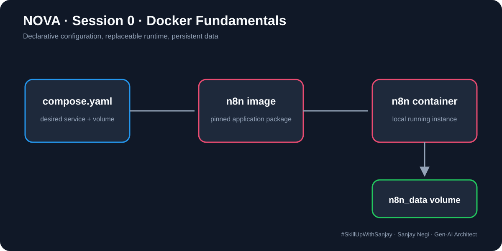

> **NOVA — Building Agentic AI Systems with n8n** · **Session 0 · Milestone 0.1**

# Prerequisites and Docker Fundamentals

[NOVA](../../README.md) / [Milestone 0.1](README.md) / **Prerequisites**

## What Docker provides

- An **image** is a read-only application package. NOVA pins the official n8n image to `2.49.5`.
- A **container** is a running instance of an image. Containers are replaceable; do not treat their writable layer as a backup.
- A **volume** stores data independently of a container lifecycle.
- **Docker Compose** reads `compose.yaml` and manages the related services, network, and volume as one project.

- Compose turns the declarative YAML configuration into one n8n container, a private network, and one persistent volume.
- Recreating a container does not remove the named volume.
- The n8n image and your n8n data have separate lifecycles.

## Computer requirements

- A supported 64-bit Windows, macOS, or Linux system.
- Hardware virtualization enabled when Docker Desktop requires it.
- At least 4 GB free memory and approximately 5 GB free disk space for this learning environment.
- Administrator rights for installation, or help from your system administrator.
- Git, a modern browser, and terminal access.

Docker Desktop licensing depends on usage and organization size. Review the current [Docker Desktop terms and platform requirements](https://docs.docker.com/get-started/get-docker/) before installation.

## Terminal conventions

- **Windows:** use PowerShell unless a command is explicitly marked Bash.
- **macOS/Linux:** use Bash, Zsh, or a compatible POSIX shell.
- Run commands from the repository root—the directory containing `compose.yaml`.
- Never paste a command containing an unknown path or secret.

## Files used by this milestone

| File | Purpose | Safe to commit? |
|---|---|---|
| `compose.yaml` | Declares n8n, localhost networking, and persistent storage | Yes |
| `.env.example` | Documents required variables with non-secret placeholders | Yes |
| `.env` | Local version, timezone, and encryption key | **No**; ignored by Git |
| `.gitignore` | Prevents common local secrets/data/backups from being committed | Yes |

## Navigation

[← Milestone overview](README.md) · [Next: Install Docker →](docker-installation.md)

---

  

<strong>#SkillUpWithSanjay</strong>

  <strong>Sanjay Negi — Senior Principal Software Engineer | Gen-AI Architect</strong> 
  <a href="https://www.sanjaynegi.in">Website</a> ·
  <a href="https://www.linkedin.com/in/sanjay-negi-ai/">LinkedIn</a> ·
  <a href="../../LICENSE">MIT License</a>

