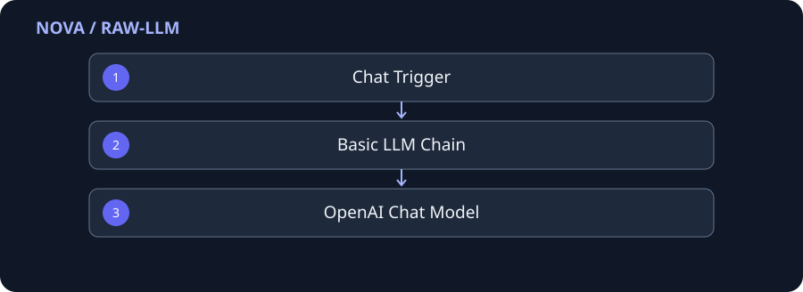
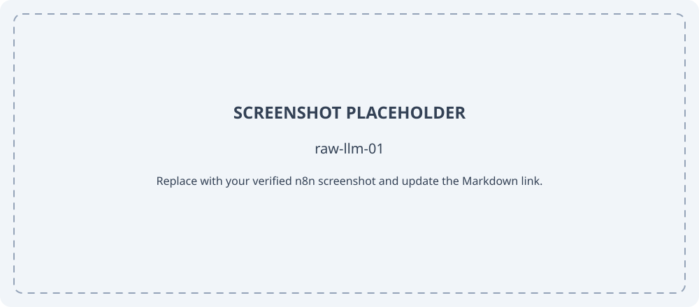
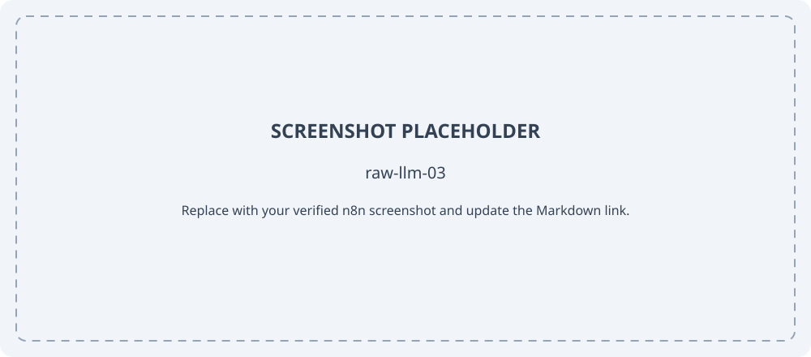

# Raw LLM

## Purpose
Demonstrate missing external access.



- Chat Trigger: Private chat
- Basic LLM Chain: Prompt: {{ $json.chatInput }}
- OpenAI Chat Model: Attach to Model port

## Build
For callable labs create Manual Trigger → Test Input (Edit Fields) and Execute Sub-workflow Trigger → Normalize Input; connect Test Input to Normalize Input. Declare inputs matching Normalize Input. Administrative, scheduled and raw LLM labs use their indicated triggers instead.

### 1. Chat Trigger

Purpose: Private chat.

Configuration:

```text
Private chat; response when last node finishes
```



### 2. Basic LLM Chain

Purpose: Prompt: {{ $json.chatInput }}.

Configuration:

```text
Prompt: {{ $json.chatInput }}
```


### 3. OpenAI Chat Model

Purpose: Attach to Model port.

Configuration:

```text
Attach to Model port; gpt-4.1-mini or supported tool-capable model
```



## Test independently
Ask about REST APIs, then unread email; model cannot retrieve actual mail.

## Integration
For callable labs add Call n8n Workflow Tool, select saved workflow, map input with `$fromAI("field", "Describe the required input", "string")` or fixed trusted ID. Test through chat. Do not expose ingestion, scheduler, error handler or approval executor as agent tools.

## Verification
Draft configuration; inspect actual output paths and add explicit failure branches before publishing.
