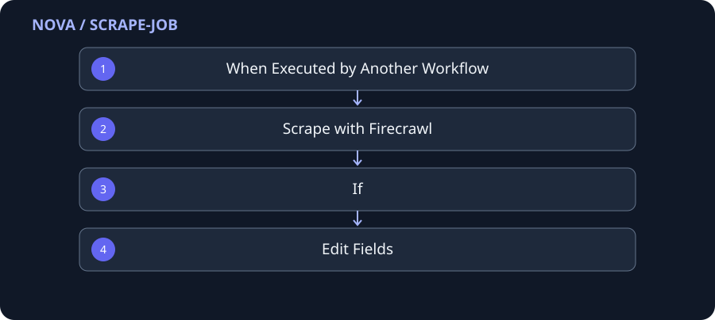
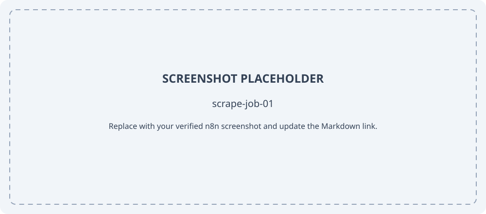
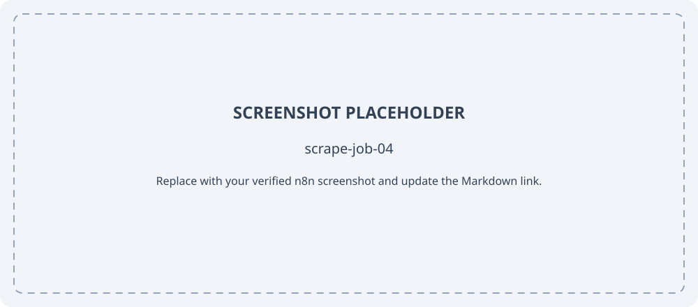

# NOVA - Scrape Job

## Purpose
Extract public job description text.



- When Executed by Another Workflow
- Scrape with Firecrawl
- If
- Edit Fields

## Build and configure

The following parameter reference is derived from the earlier Cloud export. Re-select credentials and resources; redacted values are placeholders. Do not treat this as Docker-tested.

### 1. When Executed by Another Workflow

Purpose: configure the `executeWorkflowTrigger` operation for this stage of the workflow.

```json
{
  "workflowInputs": {
    "values": [
      {
        "name": "job_url"
      }
    ]
  }
}
```



### 2. Scrape with Firecrawl

Purpose: configure the `httpRequest` operation for this stage of the workflow.

```json
{
  "method": "POST",
  "url": "https://api.firecrawl.dev/v2/scrape",
  "authentication": "genericCredentialType",
  "genericAuthType": "httpHeaderAuth",
  "sendBody": true,
  "specifyBody": "json",
  "jsonBody": "={{ {\n  url: $json.job_url,\n  formats: [\"markdown\"],\n  onlyMainContent: true\n} }}",
  "options": {
    "response": {
      "response": {}
    }
  }
}
```


### 3. If

Purpose: configure the `if` operation for this stage of the workflow.

```json
{
  "conditions": {
    "options": {
      "caseSensitive": true,
      "leftValue": "",
      "typeValidation": "strict",
      "version": 3
    },
    "conditions": [
      {
        "id": "RESELECT_IN_N8N",
        "leftValue": true,
        "rightValue": "",
        "operator": {
          "type": "boolean",
          "operation": "exists",
          "singleValue": true
        }
      },
      {
        "id": "RESELECT_IN_N8N",
        "leftValue": true,
        "rightValue": "",
        "operator": {
          "type": "boolean",
          "operation": "notEmpty",
          "singleValue": true
        }
      },
      {
        "id": "RESELECT_IN_N8N",
        "leftValue": "",
        "rightValue": "",
        "operator": {
          "type": "string",
          "operation": "equals",
          "name": "filter.operator.equals"
        }
      }
    ],
    "combinator": "and"
  },
  "options": {}
}
```


### 4. Edit Fields

Purpose: configure the `set` operation for this stage of the workflow.

```json
{
  "assignments": {
    "assignments": [
      {
        "id": "RESELECT_IN_N8N",
        "name": "job_description",
        "value": "={{ $json.data.markdown }}",
        "type": "string"
      },
      {
        "id": "RESELECT_IN_N8N",
        "name": "source_url",
        "value": "={{ $json.data.metadata.sourceURL }}",
        "type": "string"
      },
      {
        "id": "RESELECT_IN_N8N",
        "name": "status",
        "value": "success",
        "type": "string"
      }
    ]
  },
  "options": {}
}
```



## Independent testing

For specialist workflows add Manual Trigger → Edit Fields (sample inputs matching trigger schema) → first business node. Keep the sub-workflow trigger connected too. If expressions reference the sub-workflow trigger directly, normalize both entry paths and update those references before testing. Execute with valid input and inspect output; repeat with invalid input. Unpin test data.

## Integration

Add Call n8n Workflow Tool to NOVA, select saved specialist, map declared fields using `$fromAI()` or fixed C001, and test through chat. For Day 1, connect only Gmail and Calendar first; add career tools in Session 2.

## Verification

- [ ] Independent test passed
- [ ] Integration passed
- [ ] Screenshot replaced
- [ ] Sanitized export saved
