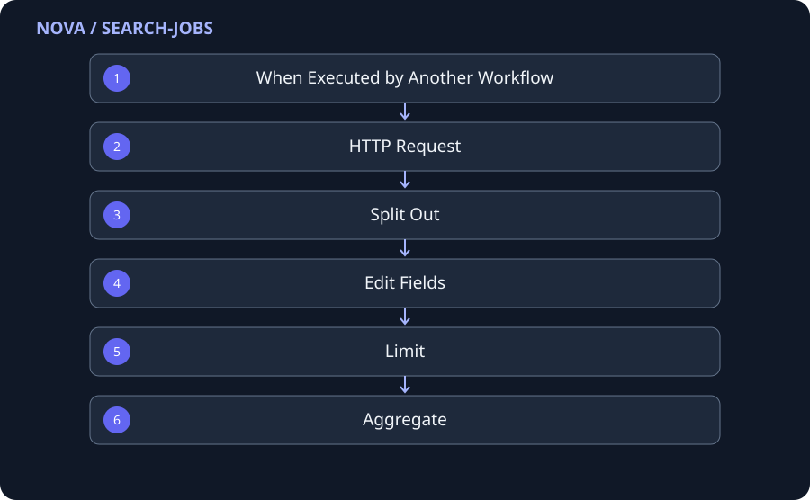
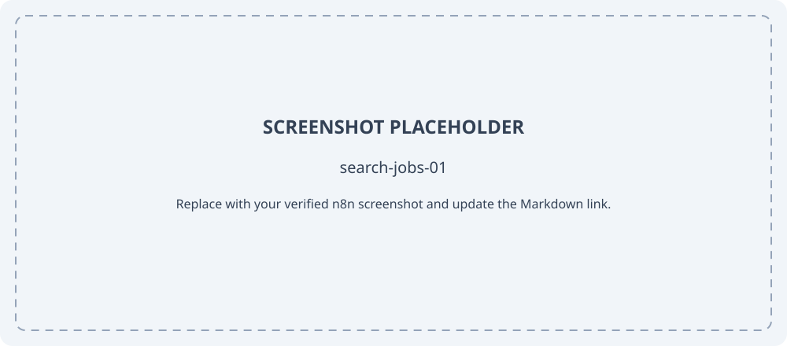
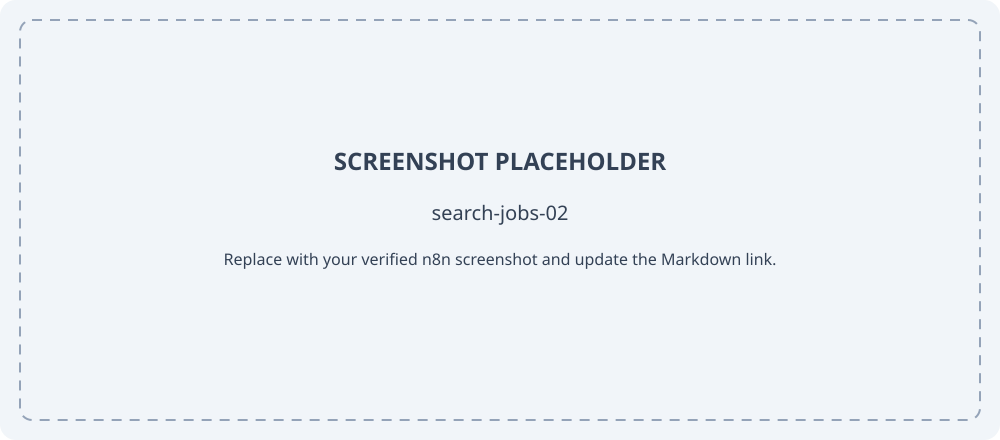
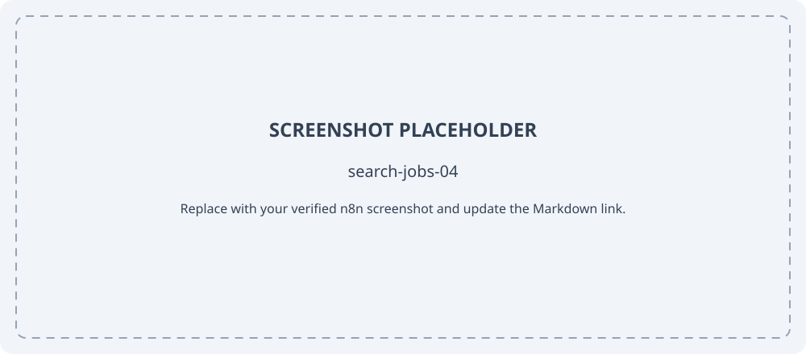
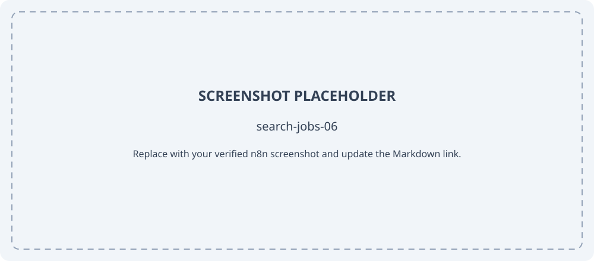

# NOVA - Search Jobs

## Purpose
Retrieve and normalize live remote job listings.



- When Executed by Another Workflow
- HTTP Request
- Split Out
- Edit Fields
- Limit
- Aggregate

## Build and configure

The following parameter reference is derived from the earlier Cloud export. Re-select credentials and resources; redacted values are placeholders. Do not treat this as Docker-tested.

### 1. When Executed by Another Workflow

Purpose: configure the `executeWorkflowTrigger` operation for this stage of the workflow.

```json
{
  "workflowInputs": {
    "values": [
      {
        "name": "keyword"
      }
    ]
  }
}
```



### 2. HTTP Request

Purpose: configure the `httpRequest` operation for this stage of the workflow.

```json
{
  "url": "https://himalayas.app/jobs/api/search",
  "sendQuery": true,
  "queryParameters": {
    "parameters": [
      {
        "name": "q",
        "value": "={{ $json.keyword }}"
      },
      {
        "name": "sort",
        "value": "recent"
      }
    ]
  },
  "options": {
    "response": {
      "response": {
        "responseFormat": "json"
      }
    }
  }
}
```



### 3. Split Out

Purpose: configure the `splitOut` operation for this stage of the workflow.

```json
{
  "fieldToSplitOut": "jobs",
  "options": {}
}
```


### 4. Edit Fields

Purpose: configure the `set` operation for this stage of the workflow.

```json
{
  "assignments": {
    "assignments": [
      {
        "id": "RESELECT_IN_N8N",
        "name": "job_guid",
        "value": "={{ $json.guid }}",
        "type": "string"
      },
      {
        "id": "RESELECT_IN_N8N",
        "name": "job_title",
        "value": "={{ $json.title }}",
        "type": "string"
      },
      {
        "id": "RESELECT_IN_N8N",
        "name": "company",
        "value": "={{ $json.companyName }}",
        "type": "string"
      },
      {
        "id": "RESELECT_IN_N8N",
        "name": "job_description",
        "value": "={{ $json.description }}",
        "type": "string"
      },
      {
        "id": "RESELECT_IN_N8N",
        "name": "application_link",
        "value": "={{ $json.applicationLink }}",
        "type": "string"
      },
      {
        "id": "RESELECT_IN_N8N",
        "name": "source",
        "value": "Himalayas",
        "type": "string"
      }
    ]
  },
  "includeOtherFields": "={{ false }}",
  "options": {}
}
```



### 5. Limit

Purpose: configure the `limit` operation for this stage of the workflow.

```json
{
  "maxItems": 5
}
```


### 6. Aggregate

Purpose: configure the `aggregate` operation for this stage of the workflow.

```json
{
  "aggregate": "aggregateAllItemData",
  "options": {}
}
```



## Independent testing

For specialist workflows add Manual Trigger → Edit Fields (sample inputs matching trigger schema) → first business node. Keep the sub-workflow trigger connected too. If expressions reference the sub-workflow trigger directly, normalize both entry paths and update those references before testing. Execute with valid input and inspect output; repeat with invalid input. Unpin test data.

## Integration

Add Call n8n Workflow Tool to NOVA, select saved specialist, map declared fields using `$fromAI()` or fixed C001, and test through chat. For Day 1, connect only Gmail and Calendar first; add career tools in Session 2.

## Verification

- [ ] Independent test passed
- [ ] Integration passed
- [ ] Screenshot replaced
- [ ] Sanitized export saved
