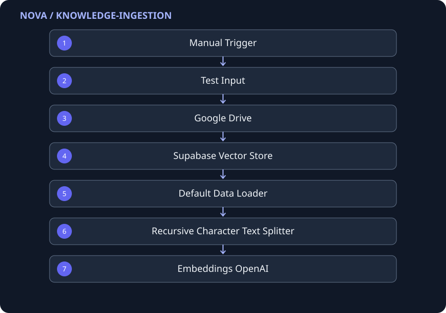
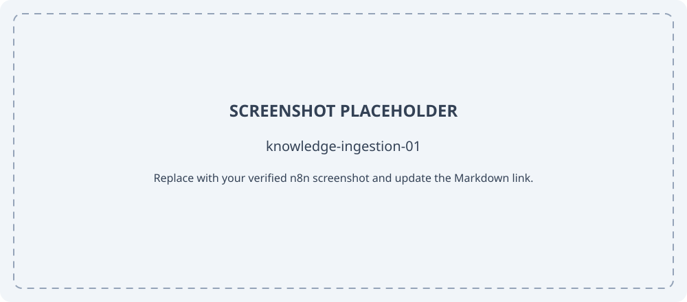
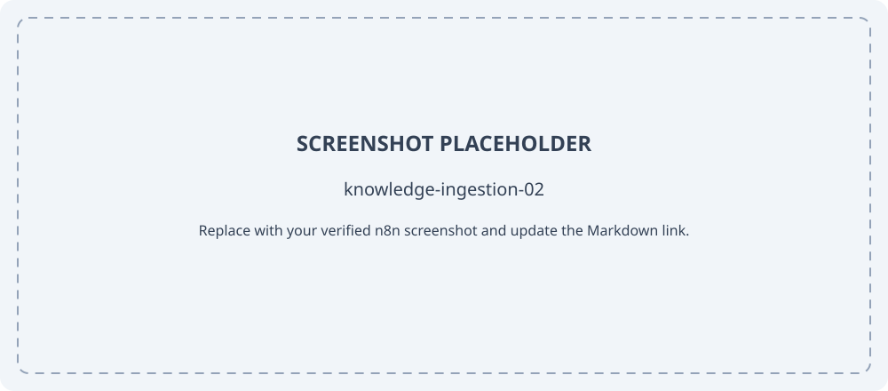
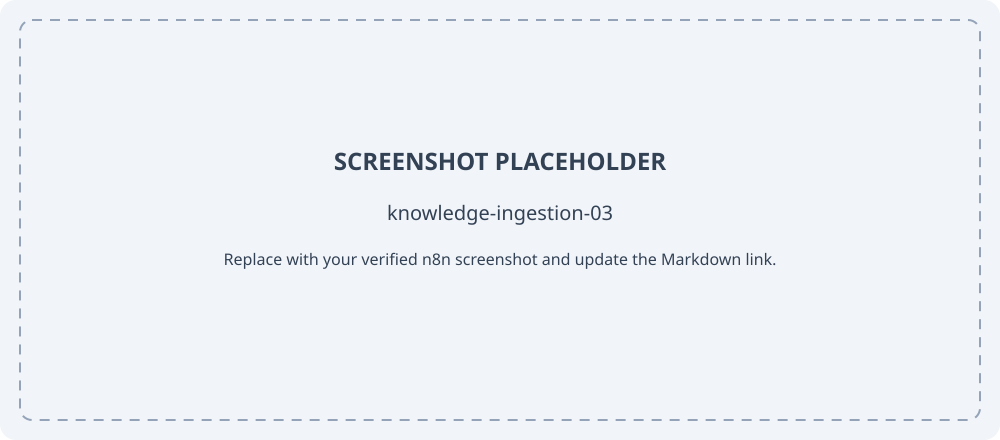
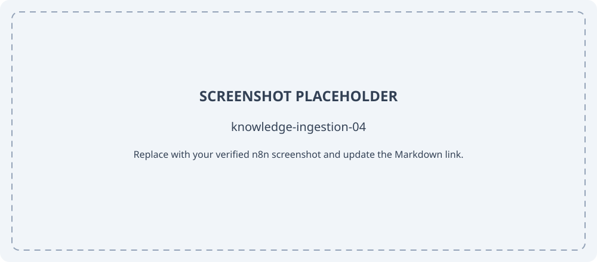
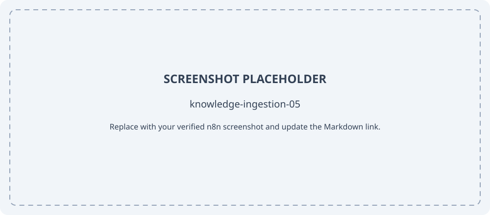
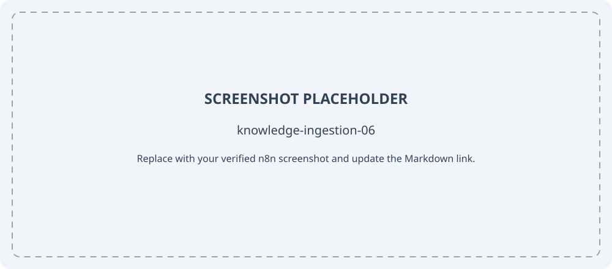
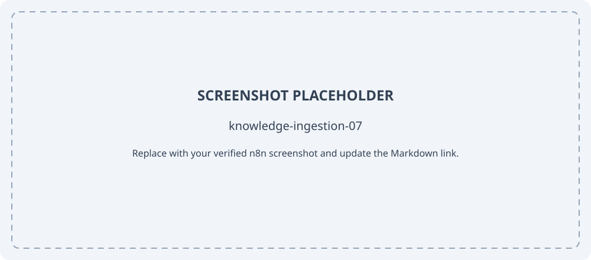

# Knowledge ingestion

## Purpose
Index fictional PDF documents.



- Manual Trigger: Default
- Test Input: file_id, source_name, source_id strings
- Google Drive: File Download
- Supabase Vector Store: Insert Documents
- Default Data Loader: Binary data
- Recursive Character Text Splitter: Chunk size 600
- Embeddings OpenAI: text-embedding-3-small

## Build
For callable labs create Manual Trigger → Test Input (Edit Fields) and Execute Sub-workflow Trigger → Normalize Input; connect Test Input to Normalize Input. Declare inputs matching Normalize Input. Administrative, scheduled and raw LLM labs use their indicated triggers instead.

### 1. Manual Trigger

Purpose: Default.

Configuration:

```text
Default
```



### 2. Test Input

Purpose: file_id, source_name, source_id strings.

Configuration:

```text
file_id, source_name, source_id strings
```



### 3. Google Drive

Purpose: File Download.

Configuration:

```text
File Download; ID {{ $json.file_id }}; binary data
```



### 4. Supabase Vector Store

Purpose: Insert Documents.

Configuration:

```text
Insert Documents; table documents
```



### 5. Default Data Loader

Purpose: Binary data.

Configuration:

```text
Binary data; PDF; custom splitter; metadata source_name and source_id from Test Input
```



### 6. Recursive Character Text Splitter

Purpose: Chunk size 600.

Configuration:

```text
Chunk size 600; overlap 100
```



### 7. Embeddings OpenAI

Purpose: text-embedding-3-small.

Configuration:

```text
text-embedding-3-small; attach to vector store
```



## Test independently
Run once per PDF; inspect documents table; avoid duplicate ingestion.

## Integration
For callable labs add Call n8n Workflow Tool, select saved workflow, map input with `$fromAI("field", "Describe the required input", "string")` or fixed trusted ID. Test through chat. Do not expose ingestion, scheduler, error handler or approval executor as agent tools.

## Verification
Draft configuration; inspect actual output paths and add explicit failure branches before publishing.
