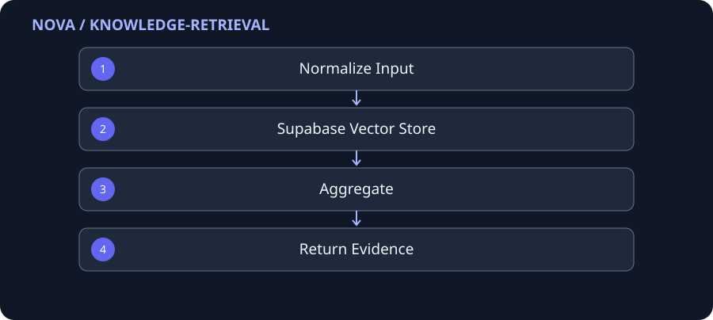
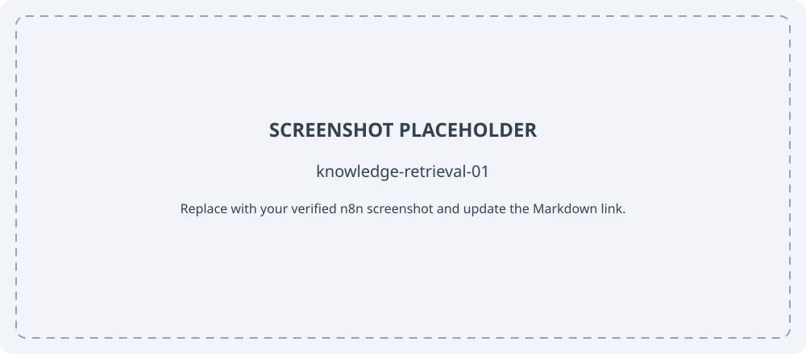
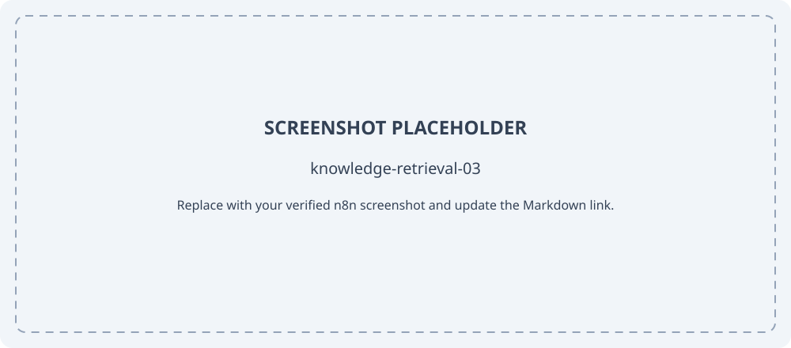
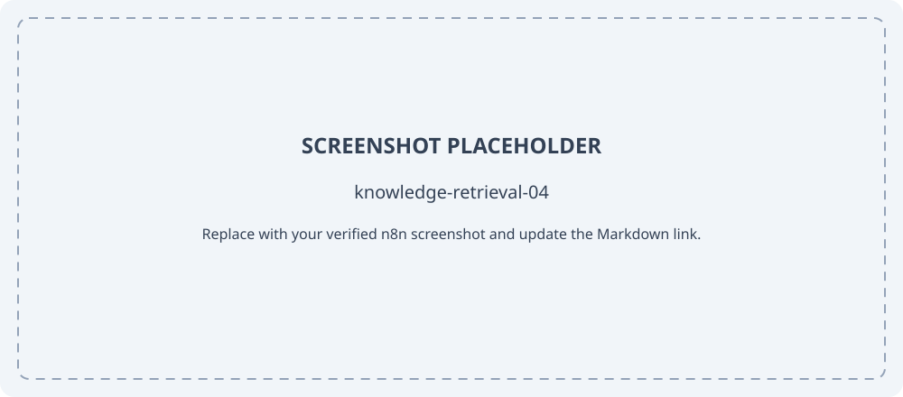

# Knowledge search

## Purpose
Retrieve evidence before generation.



- Normalize Input: question String: {{ $json.question }}
- Supabase Vector Store: Get Many
- Aggregate: All Item Data
- Return Evidence: status success

## Build
For callable labs create Manual Trigger → Test Input (Edit Fields) and Execute Sub-workflow Trigger → Normalize Input; connect Test Input to Normalize Input. Declare inputs matching Normalize Input. Administrative, scheduled and raw LLM labs use their indicated triggers instead.

### 1. Normalize Input

Purpose: question String: {{ $json.question }}.

Configuration:

```text
question String: {{ $json.question }}
```



### 2. Supabase Vector Store

Purpose: Get Many.

Configuration:

```text
Get Many; documents; prompt {{ $json.question }}; limit 4; match_documents; attach same embeddings model
```


### 3. Aggregate

Purpose: All Item Data.

Configuration:

```text
All Item Data; evidence
```



### 4. Return Evidence

Purpose: status success.

Configuration:

```text
status success; evidence Array {{ $json.evidence }}
```



## Test independently
Ask carry-forward leave days; expect evidence for six; ask unknown policy and require abstention.

## Integration
For callable labs add Call n8n Workflow Tool, select saved workflow, map input with `$fromAI("field", "Describe the required input", "string")` or fixed trusted ID. Test through chat. Do not expose ingestion, scheduler, error handler or approval executor as agent tools.

## Verification
Draft configuration; inspect actual output paths and add explicit failure branches before publishing.
