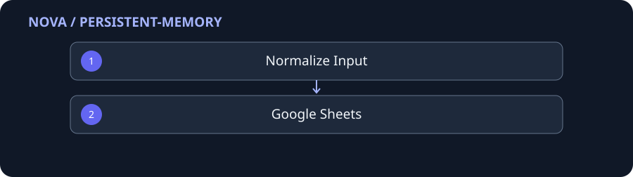
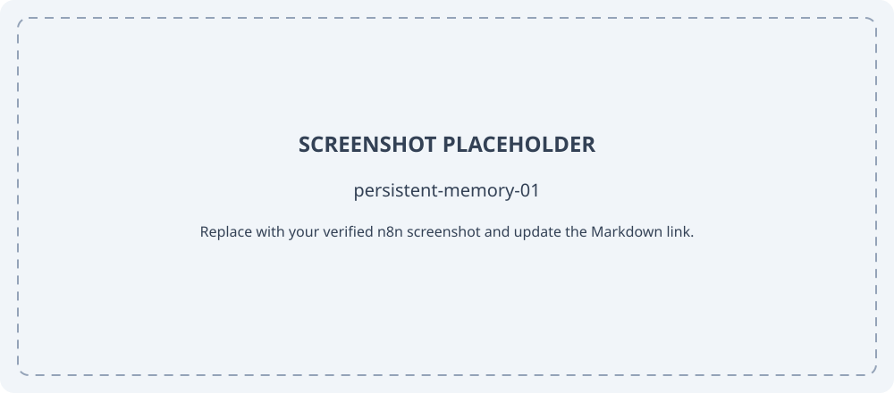
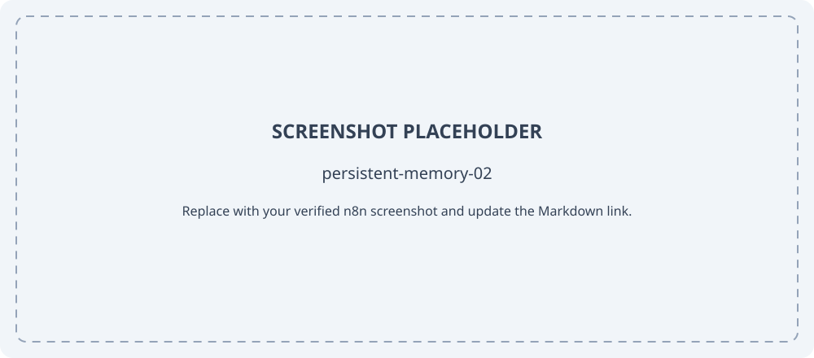

# User profile

## Purpose
Retrieve saved preferences.



- Normalize Input: user_id String U001
- Google Sheets: Get Row(s)

## Build
For callable labs create Manual Trigger → Test Input (Edit Fields) and Execute Sub-workflow Trigger → Normalize Input; connect Test Input to Normalize Input. Declare inputs matching Normalize Input. Administrative, scheduled and raw LLM labs use their indicated triggers instead.

### 1. Normalize Input

Purpose: user_id String U001.

Configuration:

```text
user_id String U001
```



### 2. Google Sheets

Purpose: Get Row(s).

Configuration:

```text
Get Row(s); NOVA-Master-Data / UserPreferences; filter user_id = {{ $json.user_id }}
```



## Test independently
Start new chat and retrieve profile; fixed U001 tool input.

## Integration
For callable labs add Call n8n Workflow Tool, select saved workflow, map input with `$fromAI("field", "Describe the required input", "string")` or fixed trusted ID. Test through chat. Do not expose ingestion, scheduler, error handler or approval executor as agent tools.

## Verification
Draft configuration; inspect actual output paths and add explicit failure branches before publishing.
