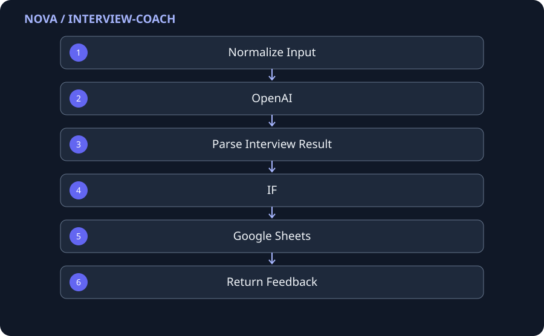
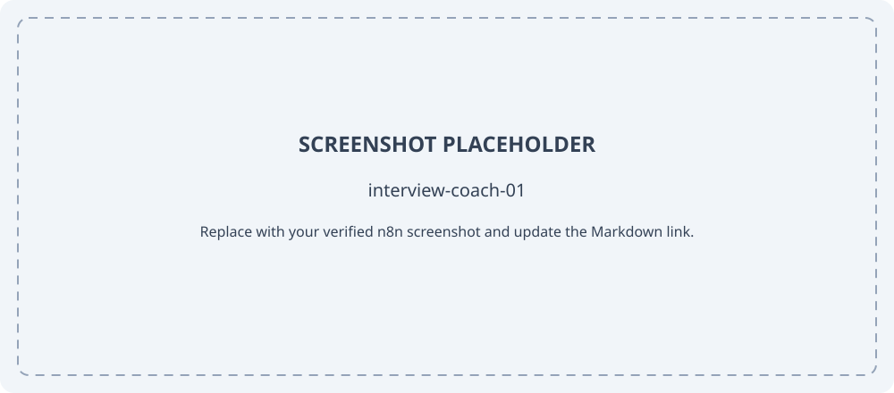
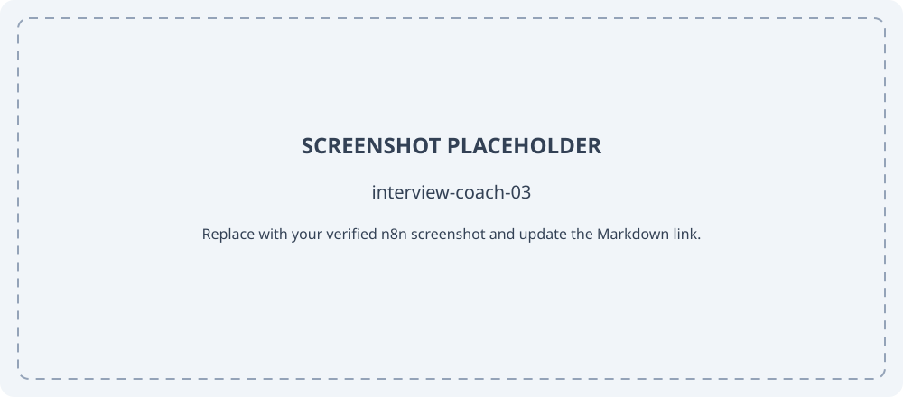
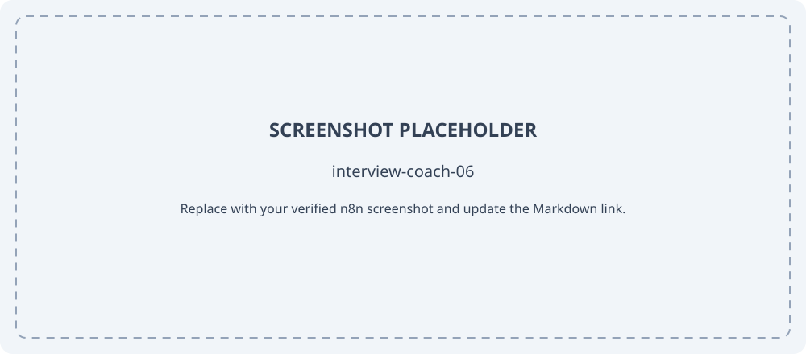

# Interview evaluation

## Purpose
Score answers and persist feedback.



- Normalize Input: session_id, question, answer Strings
- OpenAI: Message a model
- Parse Interview Result: evaluation Object {{ JSON.parse($json.output[0].content[0].text) }}
- IF: {{ Number.isInteger($json.evaluation.score) && $json.evaluation.score >= 0 && $json.evaluation.score <= 10 && !!$json.evaluation.feedback }}
- Google Sheets: Append Row InterviewHistory
- Return Feedback: evaluation {{ $("Parse Interview Result").first().json.evaluation }}

## Build
For callable labs create Manual Trigger → Test Input (Edit Fields) and Execute Sub-workflow Trigger → Normalize Input; connect Test Input to Normalize Input. Declare inputs matching Normalize Input. Administrative, scheduled and raw LLM labs use their indicated triggers instead.

### 1. Normalize Input

Purpose: session_id, question, answer Strings.

Configuration:

```text
session_id, question, answer Strings
```



### 2. OpenAI

Purpose: Message a model.

Configuration:

```text
Message a model; interview-evaluator.md; supply question and answer
```


### 3. Parse Interview Result

Purpose: evaluation Object {{ JSON.parse($json.output[0].content[0].text) }}.

Configuration:

```text
evaluation Object {{ JSON.parse($json.output[0].content[0].text) }}
```



### 4. IF

Purpose: {{ Number.isInteger($json.evaluation.score) && $json.evaluation.score >= 0 && $json.evaluation.score <= 10 && !!$json.evaluation.feedback }}.

Configuration:

```text
{{ Number.isInteger($json.evaluation.score) && $json.evaluation.score >= 0 && $json.evaluation.score <= 10 && !!$json.evaluation.feedback }}
```


### 5. Google Sheets

Purpose: Append Row InterviewHistory.

Configuration:

```text
Append Row InterviewHistory; session_id/question/answer from Normalize Input; score and feedback from evaluation; created_at {{ $now.toISO() }}
```


### 6. Return Feedback

Purpose: evaluation {{ $("Parse Interview Result").first().json.evaluation }}.

Configuration:

```text
evaluation {{ $("Parse Interview Result").first().json.evaluation }}
```



## Test independently
Answer a FastAPI background task question; score 0–10; verify row.

## Integration
For callable labs add Call n8n Workflow Tool, select saved workflow, map input with `$fromAI("field", "Describe the required input", "string")` or fixed trusted ID. Test through chat. Do not expose ingestion, scheduler, error handler or approval executor as agent tools.

## Verification
Draft configuration; inspect actual output paths and add explicit failure branches before publishing.
