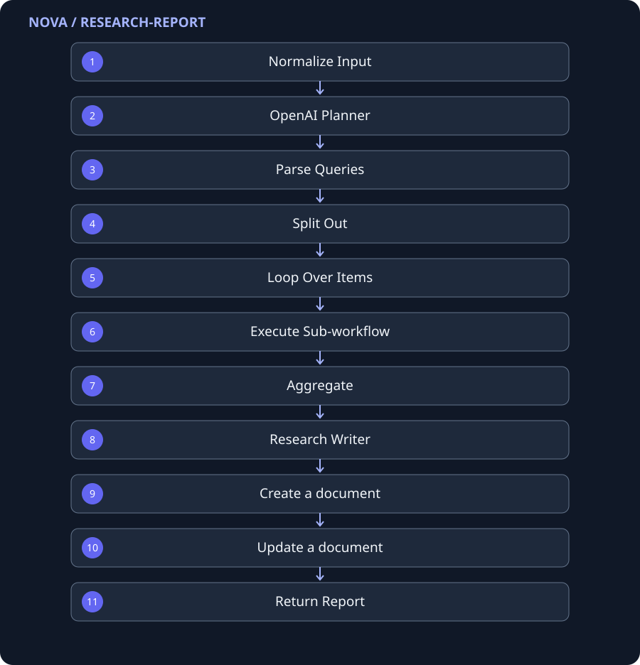
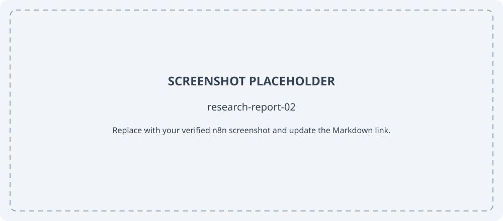
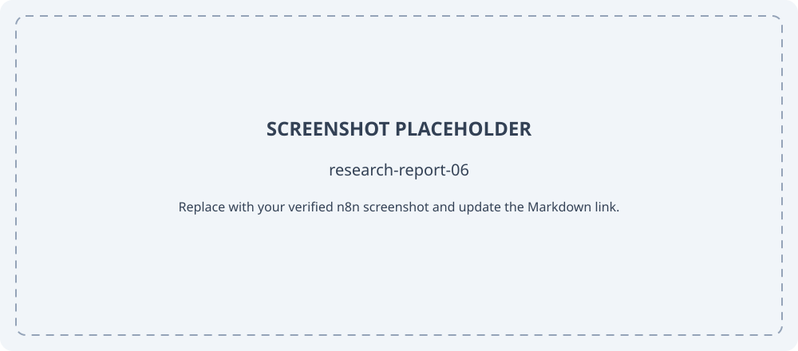
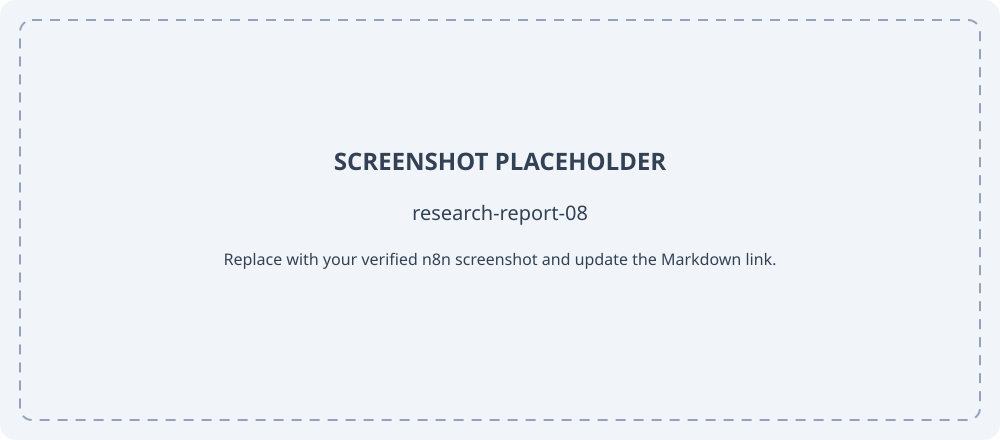
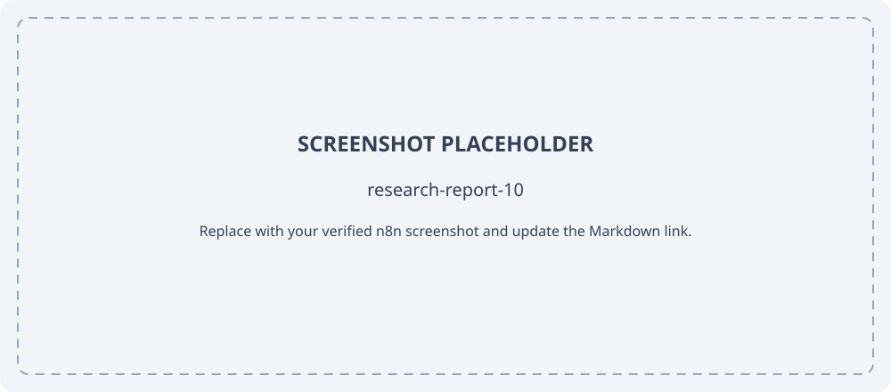
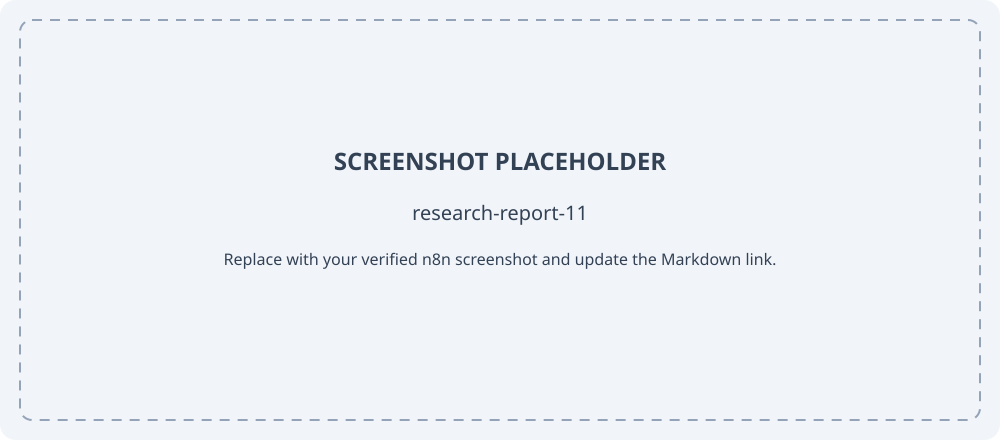

# Research report

## Purpose
Bounded planning and evidence synthesis.



- Normalize Input: topic String
- OpenAI Planner: Message a model
- Parse Queries: queries Array {{ JSON.parse($json.output[0].content[0].text).queries.slice(0,2) }}
- Split Out: queries
- Loop Over Items: Batch size 1
- Execute Sub-workflow: NOVA - Web Search
- Aggregate: Done output
- Research Writer: Message a model
- Create a document: Google Docs Create
- Update a document: ID {{ $json.id }}
- Return Report: status success

## Build
For callable labs create Manual Trigger → Test Input (Edit Fields) and Execute Sub-workflow Trigger → Normalize Input; connect Test Input to Normalize Input. Declare inputs matching Normalize Input. Administrative, scheduled and raw LLM labs use their indicated triggers instead.

### 1. Normalize Input

Purpose: topic String.

Configuration:

```text
topic String
```


### 2. OpenAI Planner

Purpose: Message a model.

Configuration:

```text
Message a model; use research-planner.md
```



### 3. Parse Queries

Purpose: queries Array {{ JSON.parse($json.output[0].content[0].text).queries.slice(0,2) }}.

Configuration:

```text
queries Array {{ JSON.parse($json.output[0].content[0].text).queries.slice(0,2) }}; validate nonempty
```


### 4. Split Out

Purpose: queries.

Configuration:

```text
queries
```


### 5. Loop Over Items

Purpose: Batch size 1.

Configuration:

```text
Batch size 1
```


### 6. Execute Sub-workflow

Purpose: NOVA - Web Search.

Configuration:

```text
NOVA - Web Search; query {{ $json.queries }}; wait; connect back to loop
```



### 7. Aggregate

Purpose: Done output.

Configuration:

```text
Done output; All Item Data; research_results
```


### 8. Research Writer

Purpose: Message a model.

Configuration:

```text
Message a model; research-writer.md; topic from Normalize Input and evidence {{ JSON.stringify($json.research_results) }}
```



### 9. Create a document

Purpose: Google Docs Create.

Configuration:

```text
Google Docs Create; title NOVA Research
```


### 10. Update a document

Purpose: ID {{ $json.id }}.

Configuration:

```text
ID {{ $json.id }}; insert text {{ $("Research Writer").first().json.output[0].content[0].text }}
```



### 11. Return Report

Purpose: status success.

Configuration:

```text
status success; report_url {{ "https://docs.google.com/document/d/" + $("Create a document").first().json.id + "/edit" }}
```



## Test independently
Compare n8n and LangGraph; verify at most two searches and actual citations.

## Integration
For callable labs add Call n8n Workflow Tool, select saved workflow, map input with `$fromAI("field", "Describe the required input", "string")` or fixed trusted ID. Test through chat. Do not expose ingestion, scheduler, error handler or approval executor as agent tools.

## Verification
Draft configuration; inspect actual output paths and add explicit failure branches before publishing.
