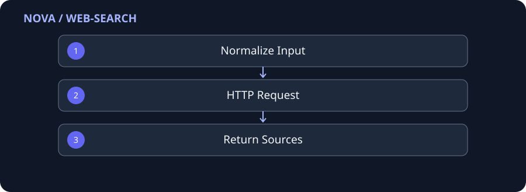
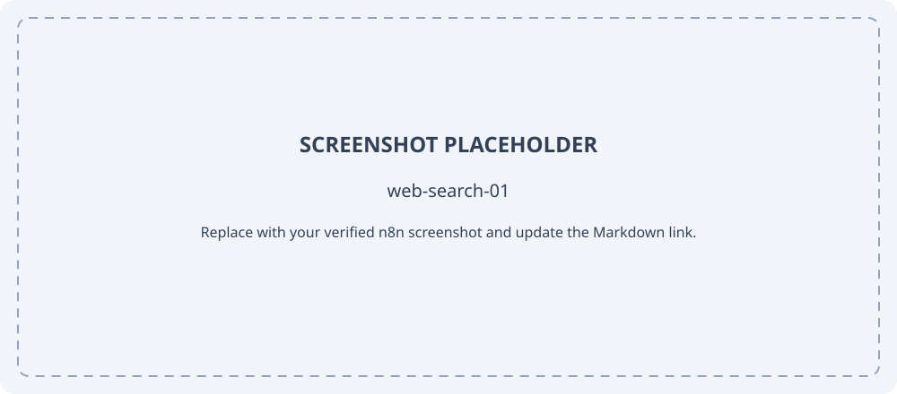
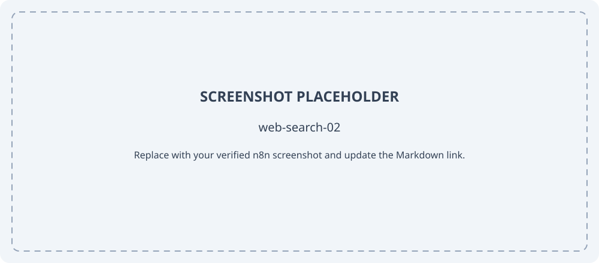
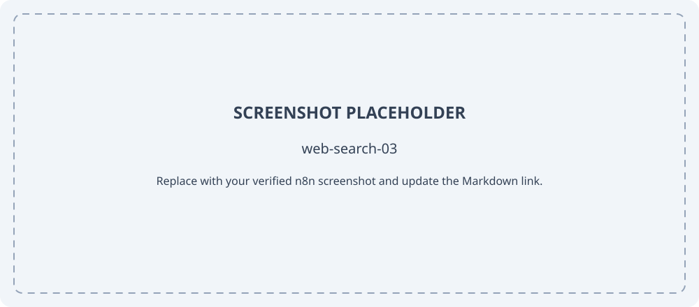

# Web search

## Purpose
Retrieve public evidence.



- Normalize Input: query String
- HTTP Request: POST https://api.tavily.com/search
- Return Sources: status success

## Build
For callable labs create Manual Trigger → Test Input (Edit Fields) and Execute Sub-workflow Trigger → Normalize Input; connect Test Input to Normalize Input. Declare inputs matching Normalize Input. Administrative, scheduled and raw LLM labs use their indicated triggers instead.

### 1. Normalize Input

Purpose: query String.

Configuration:

```text
query String
```



### 2. HTTP Request

Purpose: POST https://api.tavily.com/search.

Configuration:

```text
POST https://api.tavily.com/search; Header Auth; JSON body {{ ({query:$json.query,search_depth:"basic",max_results:5,include_answer:false,include_raw_content:false}) }}
```



### 3. Return Sources

Purpose: status success.

Configuration:

```text
status success; sources Array {{ ($json.results || []).map(r => ({title:r.title,url:r.url,content:r.content,score:r.score})) }}
```



## Test independently
Search official n8n documentation; inspect actual URLs.

## Integration
For callable labs add Call n8n Workflow Tool, select saved workflow, map input with `$fromAI("field", "Describe the required input", "string")` or fixed trusted ID. Test through chat. Do not expose ingestion, scheduler, error handler or approval executor as agent tools.

## Verification
Draft configuration; inspect actual output paths and add explicit failure branches before publishing.
