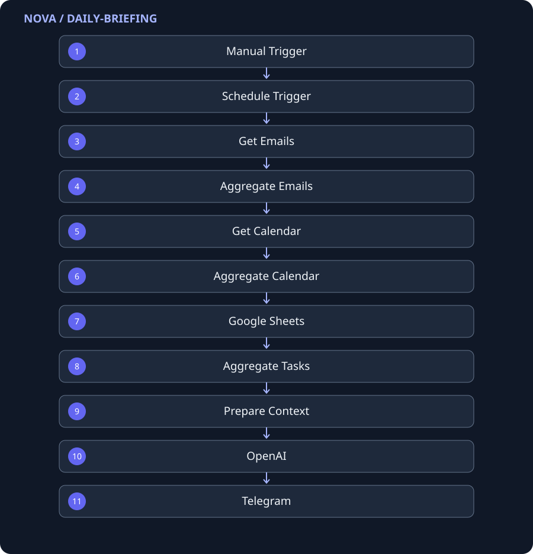
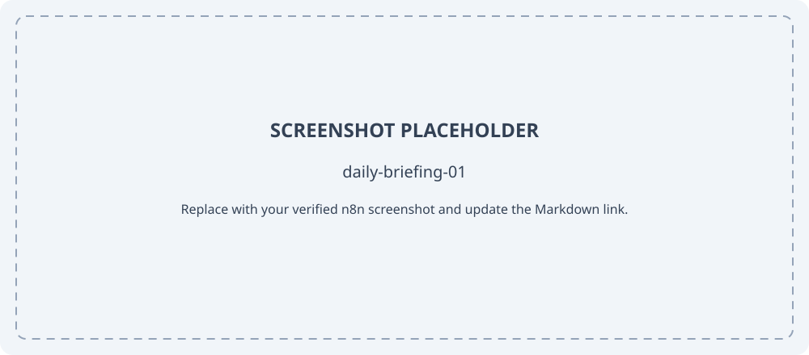
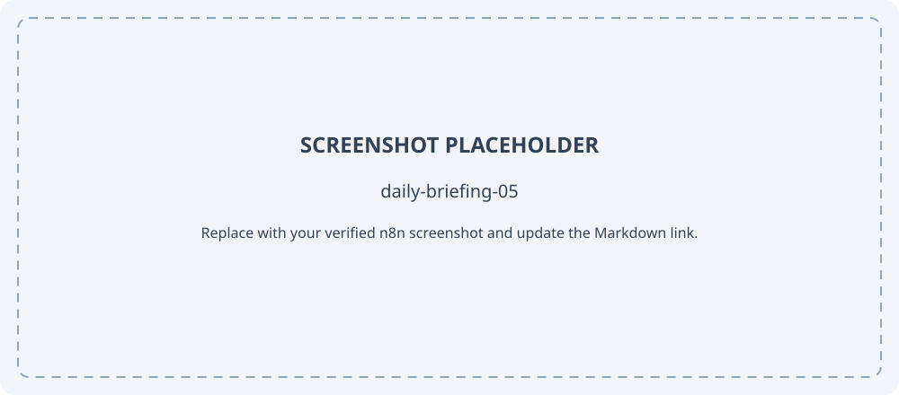
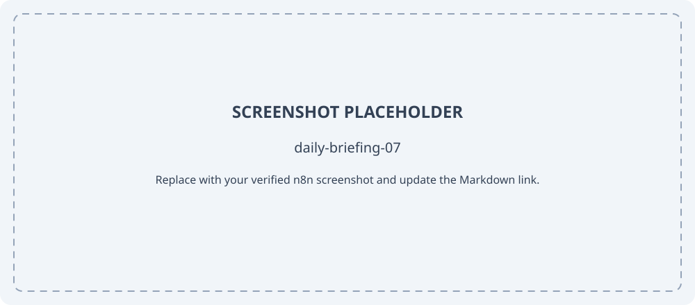
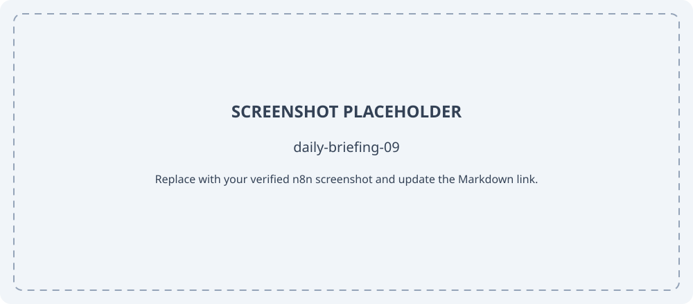
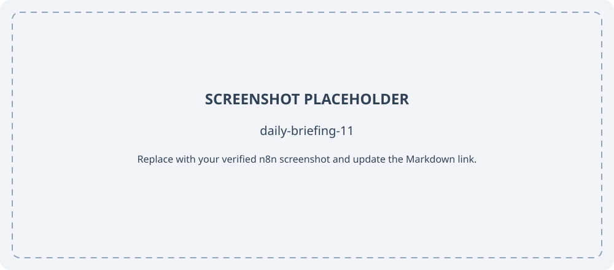

# Daily briefing

## Purpose
Send scheduled summaries.



- Manual Trigger: Default
- Schedule Trigger: Daily 08:00
- Get Emails: Gmail Get Many
- Aggregate Emails: All Item Data
- Get Calendar: Event Get Many
- Aggregate Calendar: All Item Data
- Google Sheets: Get Row(s) Tasks
- Aggregate Tasks: All Item Data
- Prepare Context: emails/events from named aggregates
- OpenAI: Message a model
- Telegram: Send Message

## Build
For callable labs create Manual Trigger → Test Input (Edit Fields) and Execute Sub-workflow Trigger → Normalize Input; connect Test Input to Normalize Input. Declare inputs matching Normalize Input. Administrative, scheduled and raw LLM labs use their indicated triggers instead.

### 1. Manual Trigger

Purpose: Default.

Configuration:

```text
Default
```



### 2. Schedule Trigger

Purpose: Daily 08:00.

Configuration:

```text
Daily 08:00; workflow timezone Asia/Kolkata; activate only after testing
```


### 3. Get Emails

Purpose: Gmail Get Many.

Configuration:

```text
Gmail Get Many; is:unread newer_than:2d; limit 10; Always Output Data
```


### 4. Aggregate Emails

Purpose: All Item Data.

Configuration:

```text
All Item Data; emails
```


### 5. Get Calendar

Purpose: Event Get Many.

Configuration:

```text
Event Get Many; after {{ $now.startOf("day").toISO() }}; before {{ $now.endOf("day").toISO() }}; Always Output Data
```



### 6. Aggregate Calendar

Purpose: All Item Data.

Configuration:

```text
All Item Data; events
```


### 7. Google Sheets

Purpose: Get Row(s) Tasks.

Configuration:

```text
Get Row(s) Tasks; status Open; Always Output Data
```



### 8. Aggregate Tasks

Purpose: All Item Data.

Configuration:

```text
All Item Data; tasks
```


### 9. Prepare Context

Purpose: emails/events from named aggregates.

Configuration:

```text
emails/events from named aggregates; tasks from current item; filter empty objects
```



### 10. OpenAI

Purpose: Message a model.

Configuration:

```text
Message a model; daily-briefing.md; user {{ JSON.stringify($json) }}
```


### 11. Telegram

Purpose: Send Message.

Configuration:

```text
Send Message; fixed verified chat ID; text {{ $json.output[0].content[0].text.slice(0,3900) }}
```



## Test independently
Manual run; verify Telegram message; then enable schedule.

## Integration
For callable labs add Call n8n Workflow Tool, select saved workflow, map input with `$fromAI("field", "Describe the required input", "string")` or fixed trusted ID. Test through chat. Do not expose ingestion, scheduler, error handler or approval executor as agent tools.

## Verification
Draft configuration; inspect actual output paths and add explicit failure branches before publishing.
