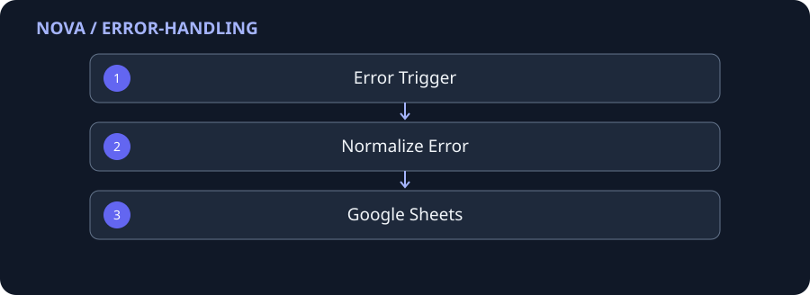
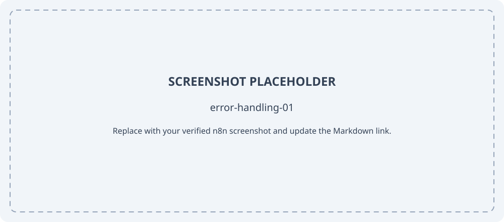
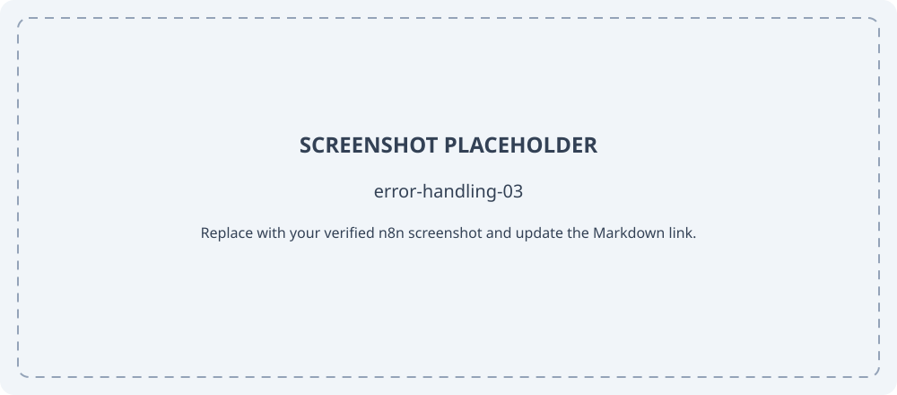

# Error handler

## Purpose
Log eligible automatic execution failures.



- Error Trigger: Default
- Normalize Error: execution_id {{ $json.execution?.id || "" }}
- Google Sheets: Append Row ExecutionLogs

## Build
For callable labs create Manual Trigger → Test Input (Edit Fields) and Execute Sub-workflow Trigger → Normalize Input; connect Test Input to Normalize Input. Declare inputs matching Normalize Input. Administrative, scheduled and raw LLM labs use their indicated triggers instead.

### 1. Error Trigger

Purpose: Default.

Configuration:

```text
Default
```



### 2. Normalize Error

Purpose: execution_id {{ $json.execution?.id || "" }}.

Configuration:

```text
execution_id {{ $json.execution?.id || "" }}; workflow {{ $json.workflow?.name || "Unknown" }}; status error; timestamp {{ $now.toISO() }}; error_message sanitized generic message
```


### 3. Google Sheets

Purpose: Append Row ExecutionLogs.

Configuration:

```text
Append Row ExecutionLogs; map fields
```



## Test independently
Assign as Error Workflow in settings; trigger automatic failure; manual executions may not invoke handler.

## Integration
For callable labs add Call n8n Workflow Tool, select saved workflow, map input with `$fromAI("field", "Describe the required input", "string")` or fixed trusted ID. Test through chat. Do not expose ingestion, scheduler, error handler or approval executor as agent tools.

## Verification
Draft configuration; inspect actual output paths and add explicit failure branches before publishing.
