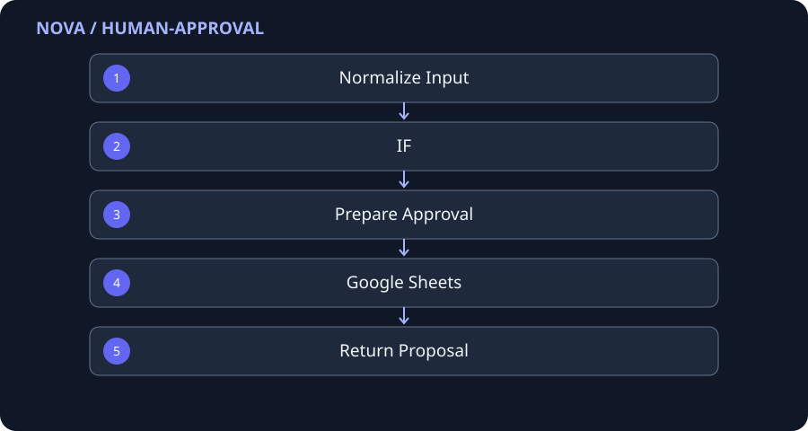
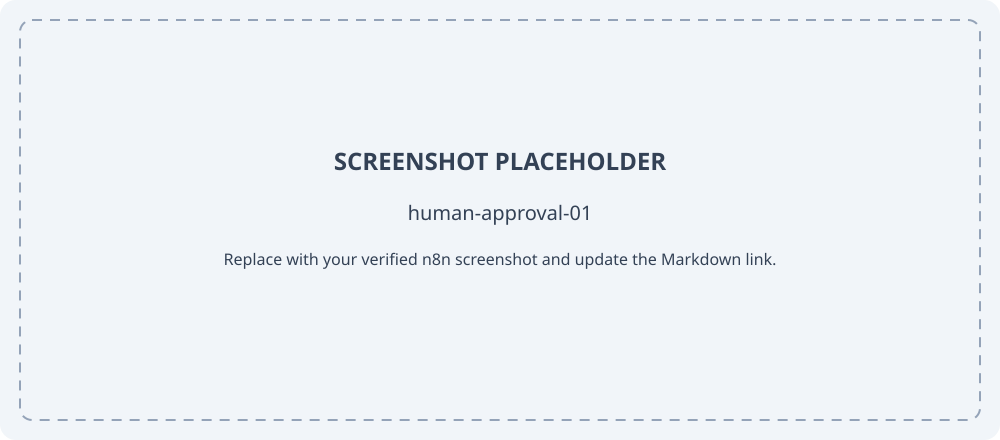
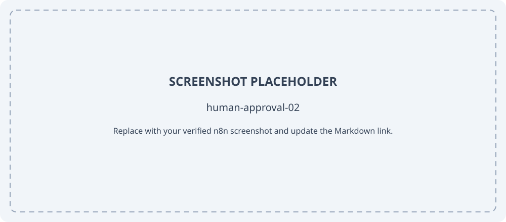
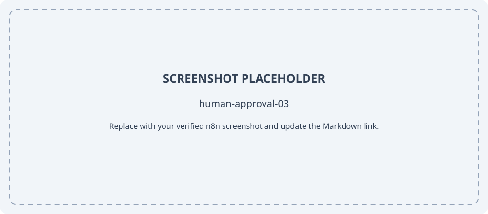

# Human approval

## Purpose
Separate proposal from execution.



- Normalize Input: recipient, subject, body Strings
- IF: Validate nonempty fields and recipient
- Prepare Approval: approval_id {{ "APR-" + $execution.id }}
- Google Sheets: Append Row ApprovalQueue
- Return Proposal: status pending_approval

## Build
For callable labs create Manual Trigger → Test Input (Edit Fields) and Execute Sub-workflow Trigger → Normalize Input; connect Test Input to Normalize Input. Declare inputs matching Normalize Input. Administrative, scheduled and raw LLM labs use their indicated triggers instead.

### 1. Normalize Input

Purpose: recipient, subject, body Strings.

Configuration:

```text
recipient, subject, body Strings
```



### 2. IF

Purpose: Validate nonempty fields and recipient.

Configuration:

```text
Validate nonempty fields and recipient; restrict to own demo address
```



### 3. Prepare Approval

Purpose: approval_id {{ "APR-" + $execution.id }}.

Configuration:

```text
approval_id {{ "APR-" + $execution.id }}; action_type SEND_EMAIL; status Pending; created_at {{ $now.toISO() }}; copy inputs
```



### 4. Google Sheets

Purpose: Append Row ApprovalQueue.

Configuration:

```text
Append Row ApprovalQueue; map all fields
```


### 5. Return Proposal

Purpose: status pending_approval.

Configuration:

```text
status pending_approval; approval_id from Prepare Approval; never claim sent
```


## Test independently
Verify Pending does not send; separate manual executor reads approval_id, checks Approved and SEND_EMAIL, marks Processing, sends exact reviewed content, marks Sent. Never expose executor to agent; single executor only; reconcile partial failure.

## Integration
For callable labs add Call n8n Workflow Tool, select saved workflow, map input with `$fromAI("field", "Describe the required input", "string")` or fixed trusted ID. Test through chat. Do not expose ingestion, scheduler, error handler or approval executor as agent tools.

## Verification
Draft configuration; inspect actual output paths and add explicit failure branches before publishing.
